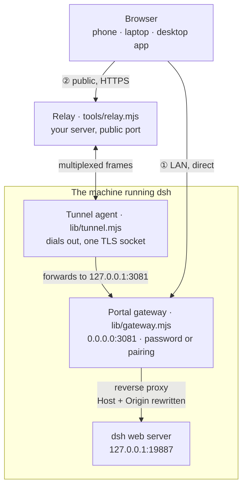
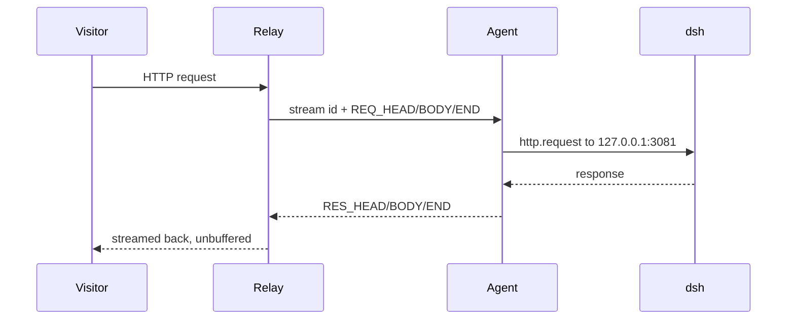

# Architecture

How the plugin is put together, and why each piece exists. Facts marked *verified*
were checked against dsh `0.2.1-rc.2`; several of them cost an afternoon to find.

Two ways in, one policy: the gateway is the only thing that authenticates, and it
never learns which way the request arrived.

## The pieces

| Piece | File | Runs on | Job |
|---|---|---|---|
| Portal gateway | `lib/gateway.mjs` | the dsh host | the only listener that authenticates; proxies to dsh |
| Host half | `index.js` | the dsh host | control routes, state, tunnel lifecycle |
| Tunnel agent | `lib/tunnel.mjs` | the dsh host | one outbound socket, multiplexes every browser connection |
| Relay | `tools/relay.mjs` | your server | public entry; one file, no dependencies |
| Panel | `client.js` | the browser | the *远程访问* page and the directory picker |
| Mobile layer | `assets/mobile.*` | the browser | drawer + reflow below 900 px |

## Why a gateway instead of "just bind 0.0.0.0"

dsh's defaults are deliberate: it refuses wildcard binds, and browsers authenticate
with a per-process launch token (`?token=…`) exchanged for a signed, authority-bound
cookie. Neither is a *user* credential — there is no password anywhere. The plugin
leaves that model alone and puts a second listener in front of it:

| | dsh web server | portal gateway |
|---|---|---|
| Bind | loopback, or one concrete interface | `0.0.0.0:<port>` |
| Who may connect | a browser holding the launch cookie | anyone with the password or a one-time pairing code |
| Login | none (the token URL *is* the login) | its own page, with lockout and a device list |
| Revocation | delete a credential and restart | per device, immediate |

The gateway still needs a dsh cookie for the browser it serves, so it mints one
(`lib/mint.mjs`): `connection.authenticatedUrl(origin)` gives a URL carrying the
process token, the gateway performs that `GET /?token=…` on loopback, and copies the
`Set-Cookie` onto its own response. The token never leaves the machine and is never
logged.

**The Host/Origin rewrite is not cosmetic.** dsh refuses a request whose `Host` is
not loopback, not the listener's own bind literal, and not a declared `trustedHosts`
entry — and refuses an `Origin` that disagrees with `Host`. A proxy that forwards the
visitor's `Host` unchanged gets 403 on every request. Cookies ignore ports, which is
why a cookie minted for `127.0.0.1:19887` still validates when it comes back through
`192.168.1.5:3081`.

## Request path

Requests the gateway answers itself: `__portal/*` (login, pairing, logout,
manifest) and `dsh-remote-portal/*` (assets, control API). Everything else is
proxied, with `Host`/`Origin`/`Referer` rewritten to the upstream authority,
`X-Forwarded-*` appended, upstream `Location` headers rewritten back to the portal,
the response streamed through unbuffered (SSE and large downloads), and WebSocket
upgrades tunnelled as raw bytes after the handshake.

## Authentication

* **Password** — `scrypt` (N=16384, r=8, p=1), 16-byte salt, plus a dummy record when
  no password is set so "is a password configured?" cannot be answered by timing.
* **Session cookie** `dsh_portal` — `<id>.<issuedAt>.<expiresAt>.<hmac>` over
  `id|issuedAt|expiresAt|sha256(UA)`. The UA is inside the MAC, so a cookie replayed
  from another browser fails exactly like a tampered one.
* **Pairing** — 32 random bytes, stored as a SHA-256 hash, single use, 180 s. This is
  what the QR code carries, so a phone never types a password.
* **Lockout** — 5 failures, then a delay that doubles to 15 min, enforced before the
  password is compared.
* **Bind safety** — a non-loopback bind with no password is refused (`needs-password`);
  `open` mode is refused anywhere but loopback. Both are panel states, not crashes.

## The relay

The agent always dials **out**, so the machine running dsh needs no inbound port,
public address, or NAT mapping.

* **One multiplexed socket.** A page load is ~75 requests; a TLS handshake per request
  over the public internet costs far more than the framing does.
* **Binary frames** (`type u8 | stream u32 | length u32 | payload`) — no base64 on
  user traffic, no JSON on the hot path.
* **Routing is a path prefix**, `/__t/<id>/`, where `<id>` is the token's hash, so a
  restart keeps the public URL. The relay strips the prefix before forwarding; dsh's
  shell resolves assets relatively (`<base href="./">`), and the plugin's own URLs are
  relative too (`__portal/login`), which is what makes a prefix work at all.
* **Failure modes are explicit**: unknown id → 404, tunnel offline → 503, no answer
  before the deadline → 504 with the stream released, wrong token → the agent never
  attaches and retries with backoff.
* **Keepalive**: the relay answers `PING` with `PONG` every 25 s; 10 s without one
  makes the agent reconnect, which is what recovers from a dead NAT mapping. The
  relay counts those reconnects and the reason for the last drop, and `drp` shows
  both.

## Browser halves

**Login page** — one self-contained document, no network requests, strict CSP
(`default-src 'none'`, `frame-ancestors 'none'`, `form-action 'self'`), and a form
that posts relatively so it works at the root and under a relay prefix.

**Panel** — a hand-written bundle with no build step, loaded through
`window.__ModuleLoader__.load({id, factory})`. It registers three surfaces and each is
independently guarded, because a throwing client plugin blanks the whole web app:

| Slot | What it is |
|---|---|
| `sidebar.panellist`, id `dsh-remote-portal` | the sidebar entry |
| `main`, key `dsh-remote-portal` | the page; the host dispatches `main` by the entry's id, so it behaves like *Plugins* / *Scheduled tasks* |
| `shell.overlay` | the directory picker — it needs its own surface because the panel already owns `main` |

Without that third registration `__DSH_DIRECTORY_PICKER__.pick()` has no receiver and
"Add workspace" does nothing, silently. That is worth remembering before deleting it.

**Mobile layer** — the shipped UI has one `@media` rule in 77 KB of CSS. The layer is
gated behind `@media (max-width: 900px)` **and** `html[data-drp-mobile]`, and keyed to
stable hooks (`[data-slot=…]`, `[role=dialog]`, `:has()`), never CSS-module hashes. It
is inert above 900 px, so the desktop app is untouched.

Whether that attribute is set is decided from facts, not from window width: an
entry-only origin (`file://`, loopback) means the machine hosting dsh, so the layer
stays off there; anything else is a remote visitor. Earlier versions guessed from
width alone and hid working controls on the desktop — that is why the decision is
now explicit and recorded in `data-drp-decision`.

## Host facts

Verified against dsh `0.2.1-rc.2`.

| Fact | Consequence |
|---|---|
| `ctx.webServer.register({kind, path, handler})`; exact match wins over prefix | control routes are safe to compose |
| `ctx.webServer.host` rejects wildcard binds | a second listener is the only way to serve a LAN |
| every request passes a Host/Origin trust fence | a proxy **must** rewrite both |
| launch token → `303` + authority-bound signed cookie, secret persisted so cookies survive a restart | the gateway can mint cookies, and phones stay logged in |
| `connection.authenticatedUrl(origin)` is the supported way to get the token | no log scraping |
| client plugins are module-loader bundles; only `react` may be required | the browser half ships as one JS file |
| the shell routes on `location.hash`; an unknown value stops the client tree mounting | deep links use `?panel=1`, never a hash |
| `dsh --dump-config` refuses the `desktop` profile | install verification skips that check there |

## Testing

| Suite | What it proves |
|---|---|
| `test/host.test.mjs` | real listeners: bind/stop/rebind, login, lockout, single-use pairing, header rewriting, upgrade tunnelling, unbuffered streaming, cookie minting, state durability, secrets never exposed |
| `test/security.test.mjs` | every portal response carries the hardening set, and proxied responses keep the app's own headers |
| `test/relay.test.mjs` | real relay + real agent + dummy upstream: prefix stripping, header forwarding, WebSocket piping, unknown/offline tunnel, wrong token, reconnect, timeout release, framing |
| `test/qr.test.mjs` | QR output against an *independent* decoder, not a round-trip through the same tables |
| `test/mobile.test.mjs` | the layer against a live dsh the suite starts itself: drawer API, hit sizes, overflow audit across 12 configurations, and that it never engages on the host machine |
| `test/manifest.test.mjs` | the release number in five files agrees, and the mirror in the installer stays pinned |

`node --test` → 82 tests, ~75 s, no mocks on the network paths.
