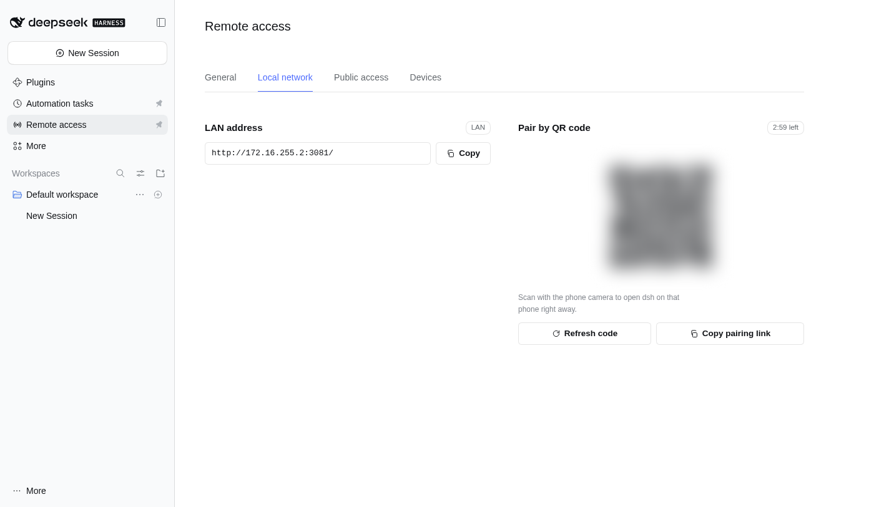
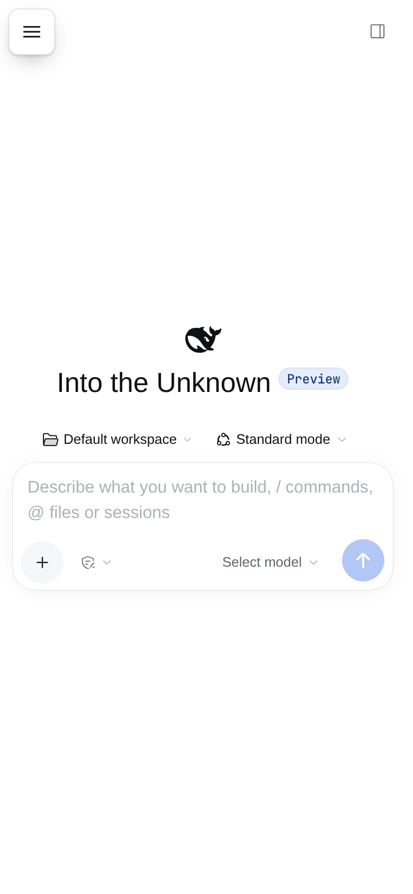
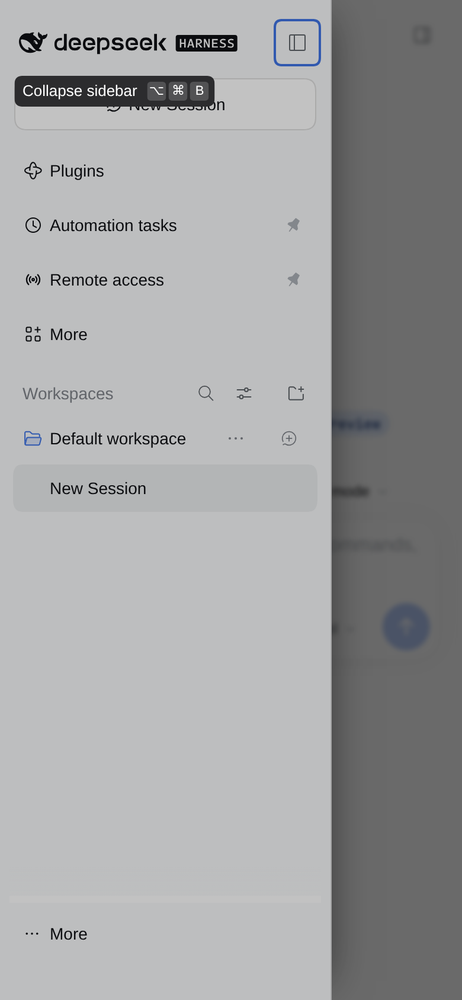
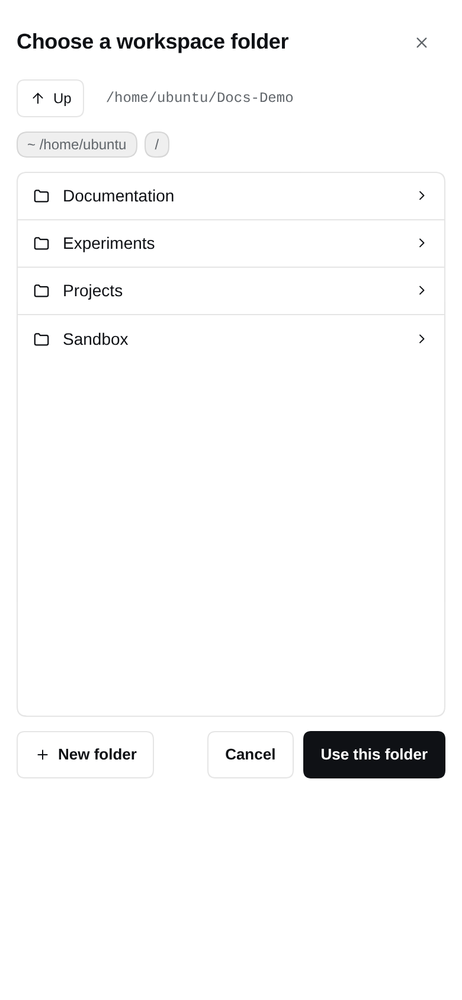

<div align="center">

[简体中文](README.md) · **English**


# YuRemote

**Remote access for DeepSeek Harness — over your LAN or through your own server.**

[](LICENSE)
[](#compatibility)
[](#)

[Features](#features) · [Install](#install) · [Update](#update) · [Public access](#public-access) · [Security](#security) · [FAQ](#faq)

</div>

---

Use DeepSeek Harness (dsh) from your phone or another computer. On the same network,
open the portal address or scan a one-time pairing code. Away from home, connect
through a relay on a server you control.

dsh still listens on loopback. The plugin runs a separate gateway that checks a
password or one-time pairing code before forwarding requests to dsh. See the
[quickstart](docs/GETTING-STARTED.md) for your first connection.

<div align="center">


<sub>The Local network tab shows the address and pairing QR code (redacted here).</sub>

</div>

## Features

| | |
|---|---|
| **One LAN address** | `http://<lan-ip>:3081/`, open it in a phone browser — no public IP, no port forwarding |
| **Scan to pair** | the panel draws a QR code: valid 180 s, single use |
| **Public access** | run the relay on **your own** server; the home machine dials out and gets a stable public URL |
| **Password and devices** | scrypt with a salt, lockout on repeated failures, per-device revocation |
| **Mobile layout** | the sidebar becomes a drawer, dialogs stop overflowing, wide tables and long code lines stop stretching the page |
| **Server-side folder picker** | "Add workspace" lists directories on the host, one level at a time, and can create one |
| **No dependencies** | Node built-ins only, no build step |

<table>
<tr>
<td width="33%" align="center"><br /><sub><b>Phone (LAN)</b></sub></td>
<td width="33%" align="center"><br /><sub><b>Sidebar drawer</b></sub></td>
<td width="33%" align="center"><br /><sub><b>Server-side folder picker</b></sub></td>
</tr>
</table>

See also the [portal sign-in screen on mobile](docs/screenshots/mobile-login.png).

## Install

**From inside dsh (recommended)**: Plugins → Add plugin → paste

```
https://github.com/tsukii12/dsh-YuRemote
```

**From a shell**:

```bash
git clone https://github.com/tsukii12/dsh-YuRemote
cd dsh-YuRemote
sh ./install.sh         # macOS / Linux, desktop + web profiles
.\install.ps1           # Windows
```

**Where GitHub is unreachable**, install from a mirror tarball instead of the URL above:

```bash
dsh plugin --profile web add \
  https://ghfast.top/https://github.com/tsukii12/dsh-YuRemote/archive/refs/heads/master.tar.gz
```

Then **restart dsh** (quit and reopen the desktop app, or `Ctrl+C` and `dsh web`).

**One required step**: sidebar → **Remote access** (远程访问) → set an access password. Until one exists
the portal refuses to listen beyond loopback. Then [open the LAN address or pair by
QR code](docs/GETTING-STARTED.md).

## Update

**Migrating from `dsh-remote-portal`?** Quit dsh first, then run the new
`./install.sh` or `./install.ps1` from a YuRemote checkout (Node.js 20+
required). Do this even if you first installed with `dsh plugin add`. The
installer replaces the old bundle and keeps the password, devices and tunnel
settings. Restart dsh afterwards.

**Installed with `install.sh` / `install.ps1`** (the plugin points at your checkout):

```bash
cd dsh-YuRemote && git pull
```

then restart dsh. No reinstall needed.

**Installed with `dsh plugin add`: remove, then add** — repeating "add plugin" with the same source may not fetch new
code (pnpm answers `Already up to date` when the spec is unchanged):

```bash
dsh plugin --profile web remove yuremote
dsh plugin --profile web add    https://github.com/tsukii12/dsh-YuRemote
```

Use `--profile desktop` for the desktop app; run it once per profile you installed into.
`dsh plugin` needs pnpm on PATH (if it says "pnpm was not found", run `npm install -g pnpm` first).

**Restart dsh afterwards.** The host half (`index.js`, `lib/*`) only loads at startup;
reloading the page swaps just the client half.

> On a slow link `add` can fail with `ETIMEDOUT`. Run it again — what was downloaded is
> reused.

**Pin a version**:

```bash
dsh plugin --profile web add https://github.com/tsukii12/dsh-YuRemote#v0.6.0
```

See [CHANGELOG.md](CHANGELOG.md) for what changed.

## Public access

Run the relay on **your own** server (one file, no dependencies). **No checkout
needed** — one command:

No Node? The installer installs a self-contained runtime itself (official tarball,
nothing added to apt/yum, kept in `/usr/local/lib/nodejs`) and carries on.

```bash
curl -fsSL https://raw.githubusercontent.com/tsukii12/dsh-YuRemote/master/tools/deploy-relay.sh | sudo bash
```

**Behind a restrictive network** (any one of these):

```bash
# recommended: the ghfast proxy (tracks master, always the newest release)
curl -fsSL https://ghfast.top/https://raw.githubusercontent.com/tsukii12/dsh-YuRemote/master/tools/deploy-relay.sh | sudo bash

# fallback: jsDelivr (also tracks master, but it caches and can lag by hours)
curl -fsSL https://cdn.jsdelivr.net/gh/tsukii12/dsh-YuRemote@master/tools/deploy-relay.sh | sudo bash
```

It downloads `relay.mjs` itself, inspects the host, asks a few questions (Enter accepts
every default), installs, and registers a `yuremote` command.

**It asks how visitors connect**:

| Question | Meaning |
|---|---|
| HTTP or HTTPS | `1) HTTP` unencrypted / `2) HTTPS` |
| HTTPS with a domain or the IP | **Domain**: no browser warning once a certificate is in place. **IP**: self-signed, one warning, encrypted from then on |
| DNS | the domain is **actually resolved** (1.1.1.1 first, so a stale local cache cannot mislead): it continues only when it points here; pointing elsewhere (a CDN, say) is reported so you can continue or pick another name; a missing A record is reported before anything is written |
| Certificate | `1) automatic, HTTP check` (needs port 80 free) / `2) automatic, DNS check` (works when 80 is blocked: Cloudflare token or a manual TXT record) / `3) I have one` (paste the PEM or give a path) / `4) self-signed` (the browser will warn) |
| Ports | public port and agent port (ports already in use are skipped; the public port defaults to 8443 when 80/443 are blocked for the domain) |

⚠️ With HTTP the password and **the entire session** (chat, files, command output)
travel in the clear. Only acceptable on a fully trusted LAN.

Prefer to read before running? Download it, then run it — same result.

```bash
curl -fsSLO https://raw.githubusercontent.com/tsukii12/dsh-YuRemote/master/tools/deploy-relay.sh
sudo bash deploy-relay.sh
```

When it finishes:

```console
$ yuremote
service     running · autostart on
uptime      2h 14m
agent port  relay.example.com:9443 (TLS)
visitor     0.0.0.0:443 (TLS, self-signed)
endpoint    tls://relay.example.com:9443
relay       reachable
tunnel      connected · 2 streams
traffic     in 8.0 MiB · out 7.9 MiB · 2140 requests · 3 clients
public      https://relay.example.com/__t/EXAMPLE_ID/
```

**Updating the relay**: run the same command again — the token and certificate are
reused and the ports do not move. One relay can serve several machines: `yuremote token add` mints another token, `yuremote tokens` lists them and `yuremote urls` lists their addresses. `yuremote config K=V …` changes a saved answer and
reinstalls the unit; `yuremote uninstall` removes everything.

In the panel, enter the relay endpoint printed by the installer, for example
`tls://relay.example.com:9443`. With just a host and port, the client tries TLS
first and falls back to plain TCP. Full guide:
[docs/DEPLOY-SERVER.md](docs/DEPLOY-SERVER.md).

## Security

* The portal is the only door: with no password set it refuses to listen beyond loopback.
* Session cookie `dsh_portal`: `HttpOnly`, `SameSite=Lax`, bound to the user agent, and
  `Secure` automatically over TLS.
* Every portal response carries a strict CSP and `X-Frame-Options: DENY`; **proxied dsh
  responses are not modified at all** (a test pins this).
* The upstream cookie is minted in the background from a host credential; the token
  never leaves the machine, never reaches a log, and is never echoed in the panel.
* Over plain HTTP a sniffer on the same network can read the cookie. Use TLS, or go
  through the relay.

Details in [SECURITY.md](SECURITY.md).

## FAQ

<details>
<summary><strong>Some buttons do nothing when I'm remote?</strong></summary>
Usually they are entries that only make sense on the host's desktop (open in Explorer,
open in VS Code, and similar).
</details>

<details>
<summary><strong>The LAN address does not open?</strong></summary>
① Is the panel state "running"? ② Is the phone on the same network? ③ Does the firewall
allow the port? ④ Is the bind address `0.0.0.0` or `auto`?
</details>

<details>
<summary><strong>The public URL does not open?</strong></summary>
`yuremote status` shows the tunnel: `offline` means the home machine never attached (check
that 9443 is open and the token matches); `connected` with a 503 means a proxy is
buffering (see the troubleshooting table in the deployment guide).
</details>

<details>
<summary><strong>Does revoking a device end my dsh session?</strong></summary>
No. Revoking only invalidates that device's portal cookie; the underlying dsh identity is
shared across devices.
</details>

## Compatibility

| | |
|---|---|
| dsh | `0.2.x` (verified item by item on `0.2.1-rc.2`) |
| profiles | `desktop` (Electron) and `web` (`dsh web`) |
| systems | Windows / macOS / Linux |
| browsers | Chrome / Edge / Safari 15.4+ / Firefox 121+ |

## Tests

Run `node --test`. Gateway and relay tests use real listeners, and QR output is
checked by an independent decoder. To run the mobile browser checks on macOS or
Linux, start dsh Web and set `CHROME_PATH`, `DSH_WEB_TEST_URL`, and
`DSH_WEB_TEST_TOKEN`. The checks skip without a browser or reachable dsh. See the
[testing guide](docs/TESTING.md).

## Documentation

- [Documentation index and repository map](docs/README.md)
- [Quickstart](docs/GETTING-STARTED.md) · [Relay deployment](docs/DEPLOY-SERVER.md)
- [Architecture](ARCHITECTURE.md) · [Testing](docs/TESTING.md)
- [CHANGELOG.md](CHANGELOG.md) — per-release notes
- [SECURITY.md](SECURITY.md) — policy

## Known limitations

* Reachable on the local network only; public access needs a relay on a server you own.
  No NAT traversal.

## License

[MIT](LICENSE)
