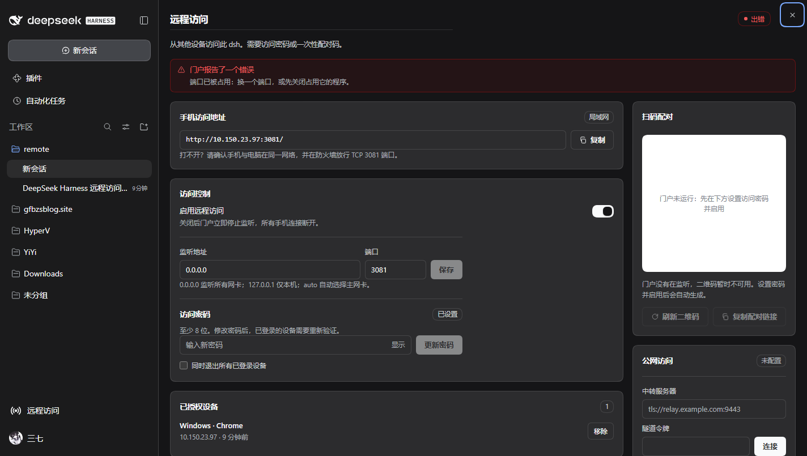
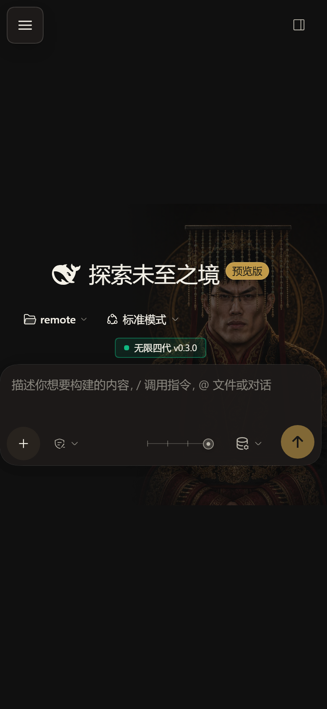
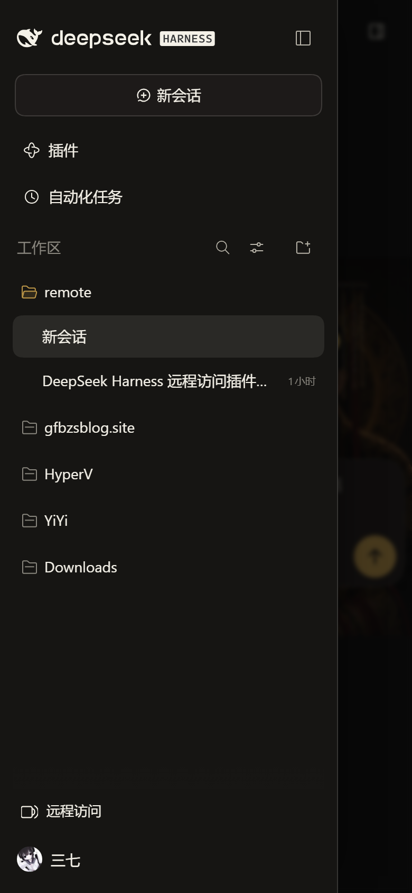
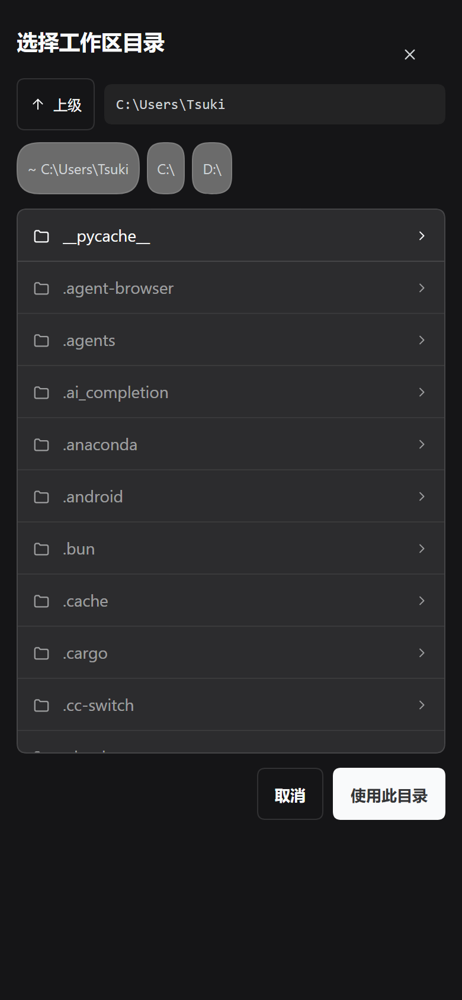

<div align="center">

[简体中文](README.md) · **English**

# dsh-remote-portal

**An authenticated front door for DeepSeek Harness: scan from a phone, reach it from outside your LAN.**

[](LICENSE)
[](#compatibility)
[](#tests)
[](#)

[Install](#install) · [Public access](#public-access) · [Features](#features) · [Security](#security) · [FAQ](#faq)

</div>

---

dsh listens on `127.0.0.1` and authenticates with a per-process launch token — unreachable from anywhere else. This plugin leaves that model untouched and puts its own gate in front of it: a second listener that asks for a password or a one-time pairing code, then reverse-proxies to the local dsh.

<div align="center">



<sub>The panel is a page of the main area (same place as Plugins / Automation); the sidebar stays usable.</sub>

</div>

## Install

**From inside dsh (recommended)**: Plugins → Add plugin → paste

```
https://github.com/tsukii12/dsh-remote-portal
```

**From a shell**:

```bash
git clone https://github.com/tsukii12/dsh-remote-portal
cd dsh-remote-portal
./install.sh            # macOS / Linux, desktop + web
.\install.ps1           # Windows
```

Then **restart dsh** (quit and reopen the desktop app, or `Ctrl+C` and `dsh web`).

**One required step**: sidebar → **远程访问** → set an access password. Until one exists the portal refuses to listen on the network.

## Behind a restrictive network

Where GitHub is unreachable, use a mirror. **Installing the plugin** (the mirror's tarball):

```bash
dsh plugin --profile web add \
  https://ghfast.top/https://github.com/tsukii12/dsh-remote-portal/archive/refs/heads/master.tar.gz
```

**The deploy script** (whichever answers):

```bash
# jsDelivr
curl -fsSL https://cdn.jsdelivr.net/gh/tsukii12/dsh-remote-portal@master/tools/deploy-relay.sh | sudo bash

# or the ghfast proxy
curl -fsSL https://ghfast.top/https://raw.githubusercontent.com/tsukii12/dsh-remote-portal/master/tools/deploy-relay.sh | sudo bash
```

When the script needs `relay.mjs` it tries **raw → jsDelivr → ghfast → gh-proxy** in turn and prints which one answered.

Pin one source: `sudo -E RELAY_RAW_BASE=https://cdn.jsdelivr.net/gh/tsukii12/dsh-remote-portal@master bash deploy-relay.sh`

**Fully offline**: fetch `relay.mjs` once elsewhere, put it next to `deploy-relay.sh`, and nothing is downloaded.

## Update

**Remove, then add** — repeating "add plugin" with the same source may not fetch new code (pnpm answers `Already up to date` when the spec is unchanged):

```bash
dsh plugin --profile web remove dsh-remote-portal
dsh plugin --profile web add    https://github.com/tsukii12/dsh-remote-portal
```

Use `--profile desktop` for the desktop app; run it once per profile you installed into.

**Restart dsh afterwards.** The host half (`index.js`, `lib/*`) only loads at startup; reloading the page swaps just the client half.

> On a slow link `add` can fail with `ETIMEDOUT`. Run it again — what was downloaded is reused.

**Pin a version**:

```bash
dsh plugin --profile web add https://github.com/tsukii12/dsh-remote-portal#v0.4.9
```

See [CHANGELOG.md](CHANGELOG.md) for what changed.

## Features

| | |
|---|---|
| **One LAN address** | `http://<lan-ip>:3081/`, opened from a phone; no public IP or port mapping |
| **QR pairing** | a 180-second, single-use code |
| **Public access** | run the relay on **your own** server; the dsh machine dials out |
| **Password + devices** | scrypt hashing, lockout, per-device revocation |
| **Mobile layout** | sidebar drawer, no overflowing dialogs, wide tables scroll |
| **Server folder picker** | "Add workspace" lists folders on the host, can create them |
| **Zero dependencies** | Node built-ins only, no build step |

<table>
<tr>
<td width="33%" align="center"><br /><sub><b>Phone (LAN)</b></sub></td>
<td width="33%" align="center"><br /><sub><b>Sidebar drawer</b></sub></td>
<td width="33%" align="center"><br /><sub><b>Server folder picker</b></sub></td>
</tr>
</table>

## Public access

Run the relay on **your own** server (single file, no dependencies). **No clone needed** — one command:

```bash
curl -fsSL https://raw.githubusercontent.com/tsukii12/dsh-remote-portal/master/tools/deploy-relay.sh | sudo bash
```

It fetches `relay.mjs` itself, detects the environment, asks a few questions (Enter accepts the defaults), finishes the setup and installs a `drp` command.

**It asks how visitors connect**:

| Question | Meaning |
|---|---|
| HTTP or HTTPS | `1) HTTP` unencrypted / `2) HTTPS` |
| HTTPS with a domain or the IP | **Domain**: no browser warning once a certificate is in place. **IP**: self-signed, one warning, encrypted from then on |
| DNS | The domain is **actually resolved**: it continues only when it points here; pointing elsewhere (a CDN, say) is reported so you can continue or pick another name; a missing A record is reported before anything is written |
| Ports | public port and agent port (ports already in use are skipped) |

⚠️ With HTTP the password and **the entire session** (chat, files, command output) travel in the clear. Only acceptable on a fully trusted LAN.

Prefer to read before running? Download it, then run it — same result.

```bash
curl -fsSLO https://raw.githubusercontent.com/tsukii12/dsh-remote-portal/master/tools/deploy-relay.sh
sudo bash deploy-relay.sh
```

Afterwards:

```console
$ drp
service     running (enabled: enabled)
agent port  1.2.3.4:9443 (TLS)
visitor     0.0.0.0:8080 (direct)
tunnel      connected, streams=0
public      http://1.2.3.4/__t/ab12cd34ef56/
```

**Updating the relay**: run the same command again — the token and certificate are reused and the ports do not move.

In the panel, the relay field takes an **`address:port`** (e.g. `1.2.3.4:9443`); the transport is detected on connect (TLS first, plain TCP as fallback). Full guide: [docs/DEPLOY-SERVER.md](docs/DEPLOY-SERVER.md).

## Security

* The portal is the only gate: no password ⇒ it never binds a non-loopback address.
* `dsh_portal` cookie: `HttpOnly`, `SameSite=Lax`, UA-bound, `Secure` under TLS.
* Every portal response carries a strict CSP and `X-Frame-Options: DENY`; proxied dsh responses are passed through **byte for byte** (a test pins this).
* Upstream authentication is minted from the host's own credential; the launch token never leaves the machine.
* Plain HTTP is sniffable on the same network — configure TLS or use the relay.

See [SECURITY.md](SECURITY.md).

## FAQ

<details>
<summary><strong>Do I have to restart dsh?</strong></summary>

Not for configuration changes. But **after an upgrade, yes**: the host half loads only at startup while the client half reloads with the page. A mismatch shows up as "the host has not loaded this endpoint yet — restart dsh".
</details>

<details>
<summary><strong>Some buttons do nothing on my phone</strong></summary>

They only act on the host's desktop ("open in Explorer", "download session log"). The plugin hides those on remote/mobile — and **never on the machine itself**, including when you open dsh through its own LAN address.
</details>

<details>
<summary><strong>The LAN address does not open</strong></summary>

① is the portal running? ② are phone and computer on the same network? ③ is the port allowed through the firewall? ④ is the bind address `0.0.0.0` or `auto`?
</details>

<details>
<summary><strong>The public URL does not open</strong></summary>

`drp status`: `offline` means the host has not dialled the relay (port 9443 open? token identical?); `connected` but 503 means proxy buffering — see the troubleshooting table in the deployment guide.
</details>

<details>
<summary><strong>Does revoking a device end its dsh session?</strong></summary>

No. It invalidates that device's portal cookie; the dsh identity is shared across devices.
</details>

## Compatibility

| | |
|---|---|
| dsh | `0.2.x` (verified on `0.2.1-rc.2`) |
| profile | `desktop` (Electron) and `web` |
| OS | Windows / macOS / Linux |
| Browsers | Chrome / Edge / Safari 15.4+ / Firefox 121+ |

## Tests

```console
$ node --test
ℹ tests 79   ℹ pass 79   ℹ fail 0
```

Real listeners, a real relay and a real page: gateway auth and proxying, security headers, relay + tunnel end to end (HTTP/HTTPS/WebSocket), QR verified by an independent decoder, and the mobile layer driven against a live dsh instance (touch-hit testing, overflow audit across six widths). Browser tests skip explicitly when Chrome is missing.

## Documentation

- [ARCHITECTURE.md](ARCHITECTURE.md) — design and verified host facts
- [docs/DEPLOY-SERVER.md](docs/DEPLOY-SERVER.md) — server deployment (systemd / Caddy / nginx / TLS)
- [docs/CONNECT.md](docs/CONNECT.md) — client connection
- [CHANGELOG.md](CHANGELOG.md) — per-release notes
- [SECURITY.md](SECURITY.md) — policy

## Known limitations

* Reachable on the same network, or through a relay you deploy yourself. No NAT traversal.
* Revoking a device does not end its dsh session.
* Safari and iOS safe areas are covered by rules, not by a physical device test.

## License

[MIT](LICENSE)
