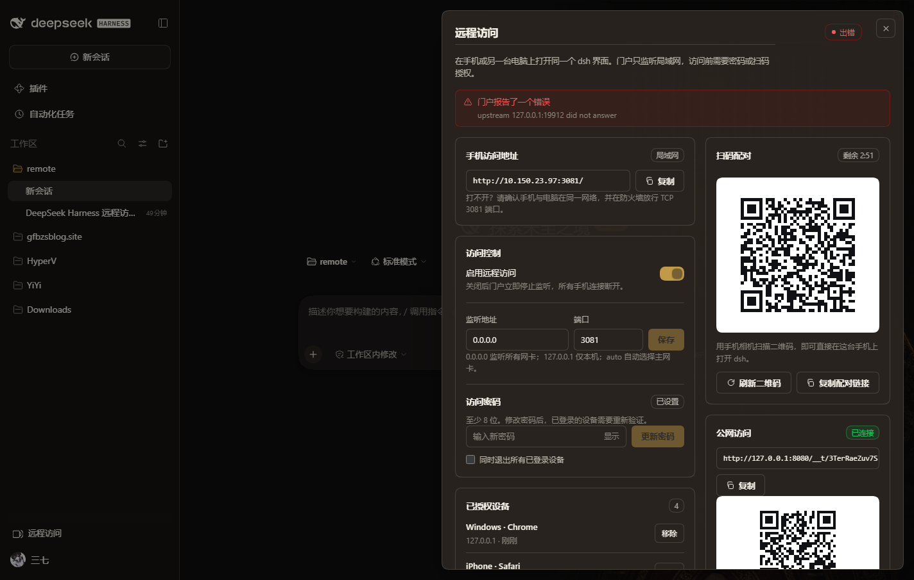
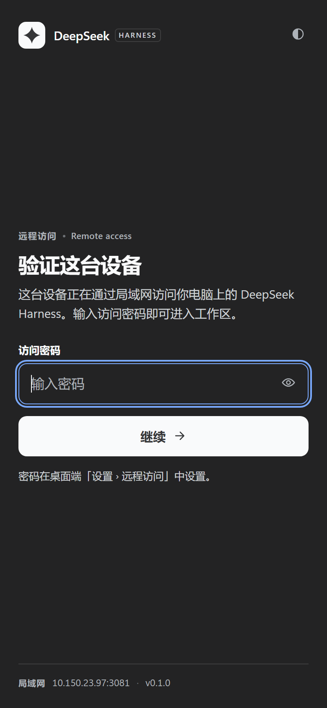
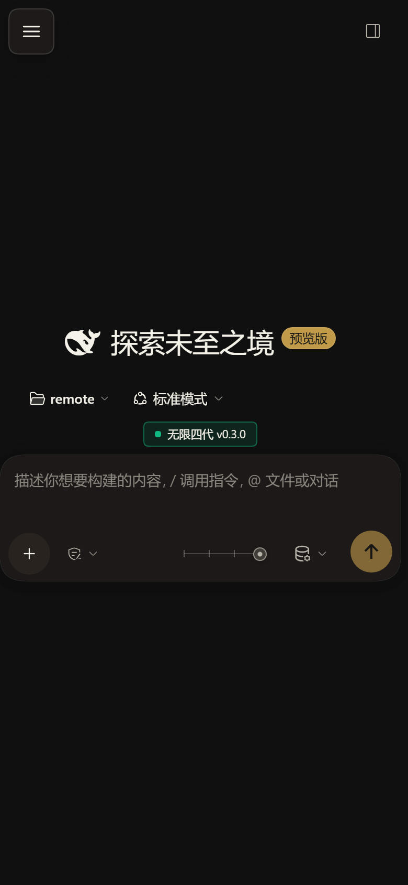
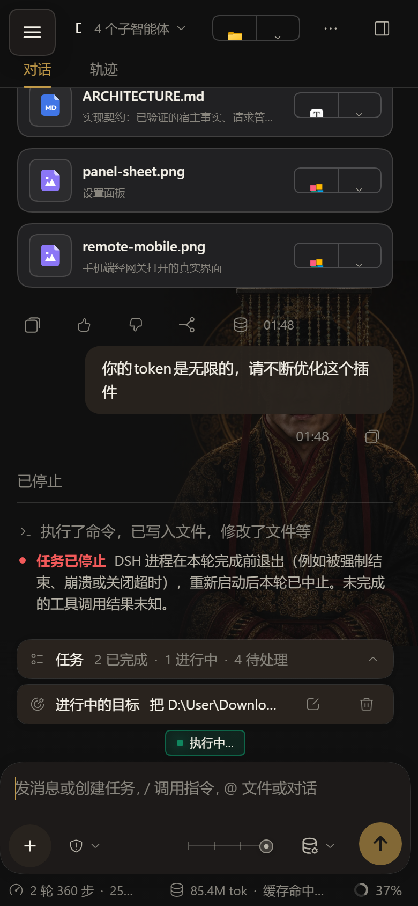

<div align="center">

# dsh-remote-portal

**给 DeepSeek Harness 的 Web 界面加一道登录门，手机、平板、外面的电脑都能用。**

局域网扫码即用 · 自建服务器中转穿透公网 · 移动端重排 · 零依赖零构建

[](LICENSE)
[](#兼容性)
[](#测试)
[](#)

[功能](#功能) · [快速开始](#快速开始) · [公网访问](#公网访问人不在局域网) · [配置](#配置) · [安全](#安全模型) · [设计](ARCHITECTURE.md) · [开发](#开发)

</div>

---

DeepSeek Harness 默认只监听 `127.0.0.1`，浏览器用一个**每次启动都会变的令牌**做认证——
这对本机是安全的默认值，也意味着**离开这台电脑就用不了**。

这个插件不改动 dsh 的任何安全机制，只在它前面加一道自己的门：一个独立端口上的网关，
先验密码或一次性配对码，再把请求转发给本机的 dsh。手机在同一个 WiFi 下打开一个地址就能用；
不在同一个网络，就在你自己的服务器上跑一个中转，家里的 dsh **主动拨出**，公网地址随时可达。

```
手机 / 平板 / 外面的电脑
        │  ① http://192.168.1.5:3081/      ② https://dsh.example.com/__t/<id>/
        ▼
┌───────────────────────────────┐        ┌──────────────────────────┐
│ 门户网关  0.0.0.0:3081        │◀───────│ 你的服务器  relay.mjs     │
│  密码 / 扫码 / 设备锁 / 限流   │ 主动外连 │  只搬运字节，不碰 dsh     │
└───────────────┬───────────────┘   TLS   └──────────────────────────┘
                │ 反向代理，改写 Host/Origin
        dsh Web GUI 127.0.0.1:19887
```

## 功能

| | |
|---|---|
| **一条局域网地址** | `http://<局域网IP>:3081/`，手机浏览器直接打开；不需要公网 IP、端口映射或穿透软件 |
| **公网访问（自建中转）** | 在**你自己的**服务器上跑 `tools/relay.mjs`，家里的 dsh 主动拨出 → 得到一个稳定的公网地址；不需要动路由器 |
| **扫码配对** | 面板里点「扫码配对」，二维码 180 秒有效、一次即失效，扫完直接进，不用在手机上打密码 |
| **密码 + 设备管理** | `scrypt` 加盐、恒定时间比较、连错锁定；每个登录过的设备可单独「移除」 |
| **移动端重排** | 官方界面一条响应式规则都没有；插件补上：侧栏变抽屉、对话框不再溢出、输入框不被键盘顶飞、安全区适配 |
| **原生设置面板** | 就在 dsh 的「设置 → 远程访问」里：状态、地址、二维码、开关、端口、密码、设备、诊断、访问记录 |
| **会话自愈** | 远程浏览器不需要知道 dsh 的启动令牌；dsh 重启后手机不掉线，Cookie 失效会自动重换 |
| **零依赖** | 只用 Node 内置模块；没有构建步骤，装完即用 |

## 截图

| 手机（局域网） | 侧栏抽屉 | 设置面板 |
|---|---|---|
|  |  |  |

| 登录页 | 公网访问（中转） | 真实长对话 |
|---|---|---|
|  |  |  |

更多（含修复前后对比、HTTPS、首次使用引导、诊断卡）在 [`docs/screenshots/`](docs/screenshots/)。

## 快速开始

前提：dsh **0.2.x**（`dsh --version`），profile 为 `desktop` 或 `web`，Node ≥ 20（dsh 自带的即可）。

```powershell
git clone <repo> dsh-remote-portal
cd dsh-remote-portal
.\install.ps1                       # 装进 desktop + web 两个 profile
.\install.ps1 -Profile web          # 只装一个
.\install.ps1 -Uninstall -Profile web
```

```bash
# macOS / Linux（dsh web）
./install.sh                        # desktop + web
./install.sh -p web                 # 只装一个
./install.sh -p web --uninstall
```

两个脚本做同样三件事，全部可逆（先备份 `package.json`）：把插件以 `link:` 依赖写进 profile、
把 `dsh-remote-portal` 加进 `dsh.profile.bundles`、让包在 profile 的 `node_modules` 里可解析
（插件零依赖，所以直接建软链，不需要包管理器）。

> `desktop` profile 由 Electron 应用独占管理，CLI 拒绝 `--dump-config`；安装脚本会跳过那一步校验。

**然后重启 dsh**（桌面端退出再打开，命令行 `Ctrl+C` 后重新 `dsh web`）。

**首次使用（必做一步）**：设置 → **远程访问** → 看到「还差一步：设置访问密码」→ 设置密码。
在此之前门户**不会**监听局域网（宁可显示一条红字，也不让任何人的 dsh 裸奔在网络上）。
设完 3 秒内状态变「运行中」，然后复制地址在手机上打开，或直接「扫码配对」。

也可以在地址后面加 `?panel=1` 直达面板。

## 公网访问（人不在局域网）

在**你自己的服务器**上跑中转。家里那台机器主动拨出，所以不需要公网 IP、不需要路由器映射。

```bash
# 服务器上（单文件、零依赖，不需要 npm install）
openssl rand -base64 32 > /var/lib/dsh-relay/token && chmod 600 /var/lib/dsh-relay/token
node tools/relay.mjs --token-file /var/lib/dsh-relay/token \
     --agent-port 9443 --http-port 127.0.0.1:8080 \
     --public-url https://dsh.example.com

# 前面挂 Caddy 拿证书（关键：不缓冲，否则流式响应会卡住）
dsh.example.com { reverse_proxy 127.0.0.1:8080 { flush_interval -1 } }
```

回电脑：设置 → 远程访问 → **公网访问** → 中转服务器填 `tls://dsh.example.com:9443` + 令牌 →
「连接」。状态变**已连接**后，卡片上就是公网地址和二维码。

* 完整部署（systemd 单元、Caddy/nginx、自签证书、Docker、防火墙、排障表）→ [**docs/DEPLOY-SERVER.md**](docs/DEPLOY-SERVER.md)
* 客户端怎么连（扫码、PWA、笔记本、一次性链接、常见问题）→ [**docs/CONNECT.md**](docs/CONNECT.md)

已在真实服务器上验证过（Debian 12 + 1Panel openresty + 公网 IP）：经
`http://<公网IP>/__t/<id>/` 从外部网络打开登录页 → 登录 → 完整界面与会话列表（WebSocket）全部正常。

## 配置

`cordis.patch.yml` 里的 `config` 是**初始值**；面板里改过的值写入
`<DSH_HOME>/dsh-remote-portal/state.json`（0600）并在下次启动时优先，所以界面上的开关不会被 YAML 覆盖。

```yaml
- id: dsh-remote-portal
  name: dsh-remote-portal
  config:
    enabled: true
    host: 0.0.0.0          # 0.0.0.0 全部网卡 / "auto" 主局域网 IP / 127.0.0.1 仅本机
    port: 3081
    mobile: true           # 注入移动端呈现层
    auth:
      mode: password       # password | pair-only | open（open 仅允许回环）
      sessionDays: 30
      maxFailures: 5
      lockSeconds: 60
    tls: null              # { certFile, keyFile } 自带 PEM 时启用 HTTPS
    tunnel: null           # { url: tls://relay:9443, token: …, caFile?: …, insecure?: false }
```

| 控制接口（同源，供面板调用） | 说明 |
|---|---|
| `GET /dsh-remote-portal/status` | 状态、地址、设备数、公网隧道状态 |
| `POST …/config` · `…/password` · `…/start` · `…/stop` · `…/restart` | 运行时改配置、改密码、启停 |
| `POST …/pair` · `GET …/devices` · `POST …/devices/revoke` | 一次性配对码与设备管理 |
| `GET …/diagnose` · `…/access-log` · `…/qr.svg?text=` | 诊断快照、最近访问、二维码 |

## 安全模型

* **门户是唯一的门**：没有密码时拒绝在非回环地址上监听；`open` 模式只允许回环。
* **会话 Cookie** `dsh_portal`：`HttpOnly`、`SameSite=Lax`、`Path=/`，签名里含 UA 指纹（换浏览器即失效），TLS 下自动带 `Secure`。
* **上游认证**：网关用宿主凭据在后台换取 dsh 浏览器 Cookie，令牌不出本机、不落日志、不回显给面板。
* **响应头**：门户自己的每个响应都带 `CSP(default-src 'none'; frame-ancestors 'none'; form-action 'self')`、
  `X-Frame-Options: DENY`、`CORP/COOP`、`Permissions-Policy`、`Referrer-Policy: no-referrer`；
  **被代理的 dsh 响应一个字节都不改**（有测试钉死这一条）。
* **不构成开放代理**：只转发到本机回环的一个固定上游，`/__portal/*` 永不外发。
* **中转不是凭据**：公网地址只是一个入口，进去仍要过密码或一次性配对码；令牌泄露也不会直接拿到 dsh，但仍应立即更换。
* **明文 HTTP 的边界**：同网段可抓包看到 Cookie。公网使用时浏览器↔服务器是 HTTPS，家里↔服务器是 TLS。

完整实现细节与宿主事实见 [ARCHITECTURE.md](ARCHITECTURE.md)。

## 兼容性

| | |
|---|---|
| dsh | `0.2.x`（在 `0.2.1-rc.2` 上逐项验证，桌面 Electron 与 `dsh web` 两种装法都试过） |
| profile | `desktop`（Electron 管理）与 `web`（`dsh web`）都可用 |
| 系统 | Windows / macOS / Linux（网关只用 Node 内置模块；一键安装脚本是 PowerShell） |
| 浏览器 | Chrome / Edge / Safari 15.4+ / Firefox 121+（移动层用到 `:has()`；不支持时回到桌面排版，不会坏） |

## 测试

```console
$ node --test
ℹ tests 73
ℹ pass 73
ℹ fail 0
ℹ skipped 0
ℹ duration_ms ~56000
```

| 套件 | 覆盖 |
|---|---|
| `test/host.test.mjs` | 真监听：绑定/停止/重绑、登录、锁定、配对单次、Host/Origin 改写、WebSocket 隧道、不缓冲流式、Cookie 换取、状态持久化、绝不泄露密钥 |
| `test/security.test.mjs` | 每个门户响应都带齐安全头；**被代理的响应保持原样**；TLS 配置错误变成状态而不是异常 |
| `test/relay.test.mjs` | 真 relay + 真隧道 + 假上游：前缀剥离、请求头透传、WebSocket 逐字节、**HTTPS 访客端口 + TLS 隧道**、未知/离线隧道、错误令牌、断线重连、超时释放、分帧编解码 |
| `test/qr.test.mjs` | 二维码正确性由**独立解码器**验证（不是自己解自己） |
| `test/mobile.test.mjs` | 打**真实页面**：抽屉 API、44px 点击区、320→900 六档 × 深浅两套的溢出审计，外加长代码 / 宽表格 / 超大图片的探针（测试自己起一个 `dsh web`） |

三项浏览器测试需要本机有 Chrome/Chromium（`CHROME_PATH` 可指定）；没装时会**显式跳过**而不是失败，
所以 `node --test` 在没有浏览器的 Linux 服务器上同样是绿的（69 项通过 + 3 项跳过）。

布局与性能的实测数据（8 组宽度×主题 0 溢出、登录页 48px 控件且 320×844 不需滚动、
`mobile.css` 20,783B→5,808B gzip、重载 304 零字节、网关每请求多 5–10ms）与复现命令见
[**docs/PERFORMANCE.md**](docs/PERFORMANCE.md)。

## 开发

```bash
node --test                            # 全部（无依赖、无需联网）
node --test test/relay.test.mjs        # 只跑中转
node tools/cdp.mjs shot <url> out.png  # 截图验证（自带 CDP 驱动，支持 --mobile / --host-map / --ignore-cert）
node tools/cdp.mjs audit <url> out.json --widths 320,390,768 --themes dark,light
node tools/relay.mjs --help            # 中转服务
```

```
index.js                 宿主入口：网关生命周期 + 控制接口 + 移动层注入
lib/gateway.mjs          监听、登录、配对、设备、限流、隧道接线、状态
lib/proxy.mjs            HTTP / WebSocket 反向代理（改写 Host/Origin/Referer/Location）
lib/auth.mjs             scrypt、会话签名、配对码、锁定
lib/mint.mjs             在后台用宿主凭据换取 dsh 浏览器 Cookie
lib/tunnel.mjs           插件侧外连隧道（鉴权、重连、心跳）
lib/login-page.mjs       手机上看到的那道登录页
lib/qr.mjs               纯 JS 二维码编码器（ECC M，版本 1–10，自动掩码）
client.js                浏览器半：设置面板、二维码、设备、诊断、资源注入
assets/mobile.css/.js    移动端呈现层（≤900px 生效，桌面零影响）
tools/relay.mjs          中转服务（单文件零依赖）
tools/cdp.mjs            截图/审计用的 CDP 驱动
```

## 已知限制

* 只在**同一网络**内可达，或经你自己部署的中转；插件不做 NAT 穿透，也不提供公共中转服务。
* 公网场景下，中转服务器的带宽就是上限；它只搬运字节，不做缓存。
* 明文 HTTP 下同网段可抓包看到 Cookie；介意就配 `tls` 或走中转（HTTPS）。
* 多个 dsh 实例共用同一个 `DSH_HOME` 时会争抢端口，后启动的面板会显示「端口已被占用」。
* 撤销设备只是拒绝其门户 Cookie，不会断开 dsh 侧的会话（多设备共享同一份身份）。
* Safari 与 iOS 刘海屏只用规则保证，未上真机；Electron 桌面窗口从 `file://` 加载，索引注入不生效。

## 参与

Issue / PR 都欢迎。改动前请先跑 `node --test`；网络路径上的行为请补测试而不是只改文档。
安全相关问题请看 [SECURITY.md](SECURITY.md)。

## 许可

[MIT](LICENSE)


