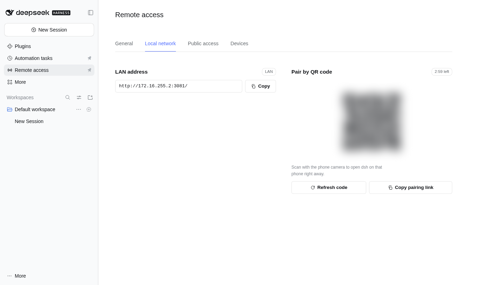
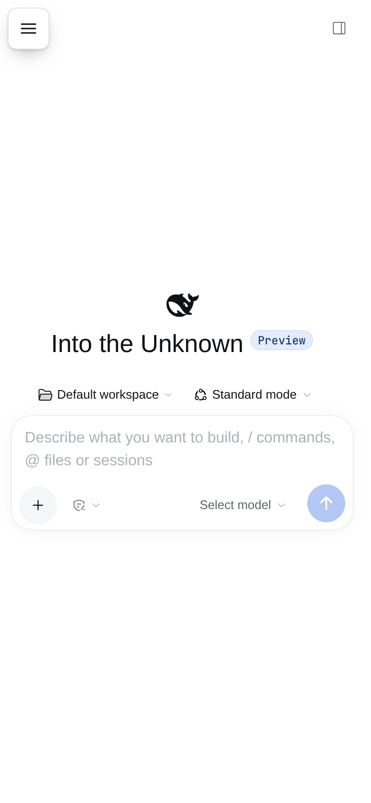
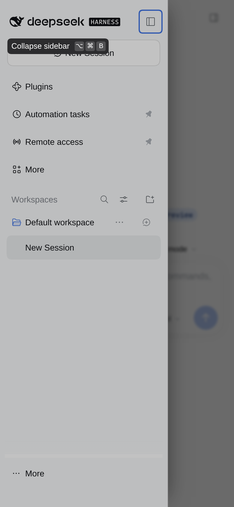
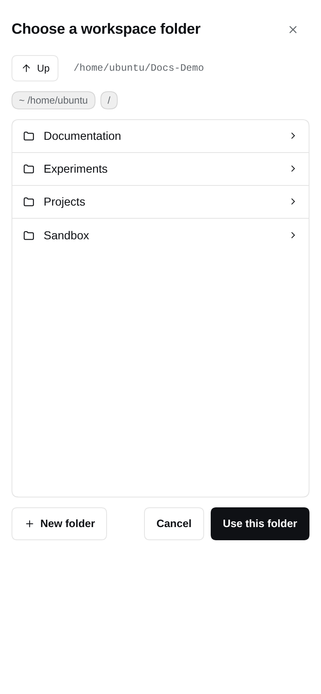

<div align="center">

**简体中文** · [English](README.en.md)

# dsh-remote-portal

[原生 iOS App（Simulator 试用）](ios/README.md)

**为 DeepSeek Harness 提供远程能力：局域网或公网远程访问。**

[](LICENSE)
[](#兼容性)
[](#)

[功能](#功能) · [安装](#安装) · [更新](#更新) · [公网访问](#公网访问) · [安全](#安全) · [常见问题](#常见问题)

</div>

---

在手机或另一台电脑上继续使用 DeepSeek Harness（dsh）。同一局域网内可以直接打开门户地址，或扫码一次性配对；在外面则可以通过自己部署的中转服务器访问。

dsh 仍只监听本机。插件在独立端口运行网关，验证访问密码或一次性配对码后，再把请求转发给 dsh。初次使用请看[快速上手](docs/GETTING-STARTED.zh-CN.md)。

<div align="center">


<sub>「局域网访问」页签显示可连接的地址和配对二维码（图中二维码已遮盖）。</sub>

</div>

## 功能

| | |
|---|---|
| **局域网一条地址** | `http://<局域网IP>:3081/`，手机浏览器直接打开，不需要公网 IP 或端口映射 |
| **扫码配对** | 面板生成二维码，180 秒有效、一次即失效 |
| **公网访问** | 在**你自己的**服务器上跑中转，服务器主动拨出，得到稳定公网地址 |
| **密码与设备** | scrypt 加盐、连错锁定、逐台设备撤销 |
| **移动端重排** | 侧栏变抽屉、对话框不溢出、长代码/宽表格/大图不撑破页面 |
| **服务器目录选择器** | 「添加工作区」列出服务器上的目录，可逐级进入、可新建文件夹 |
| **零依赖** | 只用 Node 内置模块，无构建步骤 |

<table>
<tr>
<td width="33%" align="center"><br /><sub><b>移动端</b></sub></td>
<td width="33%" align="center"><br /><sub><b>侧栏抽屉</b></sub></td>
<td width="33%" align="center"><br /><sub><b>服务器目录选择器</b></sub></td>
</tr>
</table>

另见[手机上的门户登录页](docs/screenshots/mobile-login.png)。

## 安装

**从 DeepSeek Harness 安装（推荐）**：插件 → 添加插件 → 填入

```
https://github.com/tsukii12/dsh-remote-portal
```

**从命令行装**：

```bash
git clone https://github.com/tsukii12/dsh-remote-portal
cd dsh-remote-portal
sh ./install.sh         # macOS / Linux，装进 desktop + web profile
.\install.ps1           # Windows
```

使用国内镜像：

```bash
dsh plugin --profile desktop add \
  https://ghfast.top/https://github.com/tsukii12/dsh-remote-portal/archive/refs/heads/master.tar.gz
```

装完后**重启 DeepSeek Harness**。

**首次必做一步**：侧栏 → **远程访问** → 设置访问密码。在此之前门户不会监听局域网。接下来可以[打开局域网地址或扫码配对](docs/GETTING-STARTED.zh-CN.md)。

## 更新

**用 `install.sh` / `install.ps1` 装的**（插件指向你的 checkout）：

```bash
cd dsh-remote-portal && git pull
```

然后重启 dsh，不用重新安装。

**用 `dsh plugin add` 装的：先移除，再安装：**

```bash
dsh plugin --profile desktop remove dsh-remote-portal
dsh plugin --profile desktop add    https://github.com/tsukii12/dsh-remote-portal
```

Web端把 `--profile desktop` 换成 `--profile web`。`dsh plugin` 需要 PATH 上有 pnpm（报 “pnpm was not found” 时先 `npm install -g pnpm`）。

更新后**必须重启 dsh**：宿主侧代码（`index.js`、`lib/*`）只在启动时加载，光刷新页面只换到客户端一半。

**锁定版本**：

```bash
dsh plugin --profile desktop add https://github.com/tsukii12/dsh-remote-portal#v0.6.0
```

版本记录见 [CHANGELOG.md](CHANGELOG.md)。

## 公网访问

在**你自己的**服务器上跑中转（单文件、零依赖）。一条命令：

```bash
curl -fsSL https://raw.githubusercontent.com/tsukii12/dsh-remote-portal/master/tools/deploy-relay.sh | sudo bash
```

**国内网络**：

```bash
# 推荐：ghfast 代理
curl -fsSL https://ghfast.top/https://raw.githubusercontent.com/tsukii12/dsh-remote-portal/master/tools/deploy-relay.sh | sudo bash

# 备用：jsDelivr（可能滞后数小时）
curl -fsSL https://cdn.jsdelivr.net/gh/tsukii12/dsh-remote-portal@master/tools/deploy-relay.sh | sudo bash
```

脚本会自己下载 `relay.mjs`，探测环境、逐项提问（回车即默认），完成安装并注册 `drp` 命令。

**交互式设置**：

| 提问 | 说明 |
|---|---|
| 访客如何连接 | `1) HTTP` 不加密 / `2) HTTPS` |
| HTTPS 用域名还是 IP | **域名**：配好证书后浏览器不报警；**IP**：自签证书，浏览器警告一次，之后照常加密 |
| 域名解析 | 填完域名会**实际解析一次**（优先问 1.1.1.1，避开本机缓存）：指向本机才继续；指向别处（如走了 CDN）会提示并让你决定继续还是换域名；没有 A 记录会提示先加记录 |
| 证书 | `1) 自动申请，HTTP 校验`（需 80 端口空闲）/ `2) 自动申请，DNS 校验`（80 被拦也能签：Cloudflare 令牌或手工 TXT）/ `3) 我已有证书`（粘贴 PEM 或填路径）/ `4) 自签`（浏览器提示不安全） |
| 端口 | 对外端口、中转端口（自动跳过已占用的；域名被 80/443 拦截时对外端口默认 8443） |

⚠️ 选 HTTP 时，访问密码和**全部会话内容**（聊天、文件、命令输出）在公网上是明文。只有完全可信的局域网才该这么做。

管理命令：

```console
$ drp
service     running · autostart on
uptime      2h 14m
agent port  relay.example.com:9443 (TLS)
visitor     0.0.0.0:443 (TLS, self-signed)
endpoint    tls://relay.example.com:9443
relay       reachable
tunnel      connected · 2 streams
traffic     in 8.0 MiB · out 7.9 MiB · 2140 requests · 3 clients
public      https://relay.example.com/__t/EXAMPLE_ID/
```

**更新中转**：再跑一次同一条命令即可——令牌与证书会复用，端口不会漂移。

在面板的「中转服务器」中填写安装器给出的地址，例如 `tls://relay.example.com:9443`。如果只填主机和端口，客户端会先试 TLS，再回退到明文 TCP。详见[中转部署（中文）](docs/DEPLOY-SERVER.zh-CN.md)。

## 安全

* 门户是唯一的门：没设密码就不会监听非回环地址。
* 会话 Cookie `dsh_portal`：`HttpOnly`、`SameSite=Lax`、绑定 UA，TLS 下自动 `Secure`。
* 门户自己的每个响应都带严格 CSP / `X-Frame-Options: DENY`；**被代理的 dsh 响应一个字节都不改**（有测试钉死）。
* 上游认证用宿主凭据在后台换取，令牌不出本机、不落日志、不回显面板。
* 明文 HTTP 下同网段可抓包看到 Cookie；介意就配 TLS 或走中转。

详见 [SECURITY.md](SECURITY.md)。

## 常见问题

<details>
<summary><strong>远程端某些按钮点了没反应？</strong></summary>
多数是只在桌面端有意义的入口（在资源管理器 / VS Code 中打开等）。
</details>

<details>
<summary><strong>局域网打不开？</strong></summary>
① 面板状态是否「运行中」；② 手机与电脑是否同一网段；③ 防火墙是否放行端口；④ 监听地址是否为 `0.0.0.0` 或 `auto`。
</details>

<details>
<summary><strong>公网地址打不开？</strong></summary>
一台中转可以接多台 dsh：`drp token add` 生成新令牌，`drp tokens` 列出所有隧道，`drp urls` 列出所有地址。

`drp status` 看隧道状态：`offline` 说明家里没连上中转（检查 9443 是否放行、令牌是否一致）；`connected` 但 503 说明反代缓冲（见部署文档排障表）。
</details>

<details>
<summary><strong>撤销设备会踢掉 dsh 会话吗？</strong></summary>
不会。撤销只让那台设备的门户 Cookie 失效，底层 dsh 身份是多设备共享的。
</details>

## 测试

运行 `node --test`。网关和中转使用真实监听端口，二维码由独立解码器校验。要在 macOS 或 Linux 上运行移动端浏览器测试，请启动 dsh Web，并设置 `CHROME_PATH`、`DSH_WEB_TEST_URL` 和 `DSH_WEB_TEST_TOKEN`；没有浏览器或可用的 dsh 时，这些用例会跳过。见[测试步骤](docs/TESTING.md)。

## 兼容性

| | |
|---|---|
| dsh 版本 | `0.2.x`（在 `0.2.1-rc.2` 上逐项验证） |
| profile | `desktop`（Electron）与 `web`（`dsh web`） |
| 系统 | Windows / macOS / Linux |
| 浏览器 | Chrome / Edge / Safari 15.4+ / Firefox 121+ |

## 文档

- [文档索引与项目结构](docs/README.md)
- [快速上手](docs/GETTING-STARTED.zh-CN.md) · [中转部署（中文）](docs/DEPLOY-SERVER.zh-CN.md)
- [架构（英文）](ARCHITECTURE.md) · [测试（英文）](docs/TESTING.md)
- [CHANGELOG.md](CHANGELOG.md) — 逐版本记录
- [SECURITY.md](SECURITY.md) — 安全策略

## 已知限制

* 只在同一网络内可达，公网访问需要服务器进行中转；不做 NAT 穿透。

## 许可

[MIT](LICENSE)
