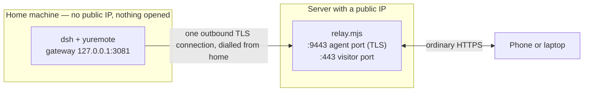

# Deploying the relay

[简体中文摘要](DEPLOY-SERVER.zh-CN.md) · [Documentation index](README.md)

> Goal: dsh runs on the computer at home, and you open a **public address** on a
> phone or laptop from the office, the subway, or a hotel. Home needs no public IP,
> no router port forwarding, and no third-party tunnel service.



The tunnel is dialled **outward by the home machine**, so nothing has to be opened
there. Visitors only ever see your server, and the password / pairing gate is still
enforced by the portal at home — the relay only moves bytes.

---

## Contents

1. [Install the plugin first](#1-install-the-plugin-first)
2. [Three deployment shapes](#2-three-deployment-shapes)
3. [One command, no arguments](#3-one-command-no-arguments)
4. [Do I need nginx? No](#4-do-i-need-nginx-no)
5. [Mirrors and offline installs](#5-mirrors-and-offline-installs)
6. [Manual deployment (advanced)](#6-manual-deployment-advanced)
7. [Managing it with `yuremote`](#7-managing-it-with-yuremote)
8. [Connecting the home machine](#8-connecting-the-home-machine)
9. [Bring your own tunnel](#9-bring-your-own-tunnel)
10. [Operations and troubleshooting](#10-operations-and-troubleshooting)
11. [Is it safe?](#11-is-it-safe)
12. [Appendix: Docker](#12-appendix-docker)

---

## 1. Install the plugin first

Inside dsh: Plugins → Add plugin → paste
`https://github.com/tsukii12/dsh-YuRemote`. Or from a shell:

```bash
git clone https://github.com/tsukii12/dsh-YuRemote
cd dsh-YuRemote && ./install.sh      # Windows: .\install.ps1
```

Restart dsh afterwards. Everything below assumes this repository's `tools/`
directory.

---

## 2. Three deployment shapes

| Shape | Fits | Needs | Key point |
|---|---|---|---|
| **A. Server + automatic HTTPS** (recommended) | you own a domain | the domain resolving to the server | the relay speaks HTTP on loopback, something else terminates TLS on 443 |
| **B. Server + self-signed TLS** | no domain, personal use | nothing | the relay terminates TLS itself with `--tls-port` |
| **C. Bring your own tunnel** | you already run frp / cloudflared / Tailscale | nothing | no relay at all; expose the portal's own port |

The installer picks A or B from your answers, and you can go further with C.

---

## 3. One command, no arguments

On a systemd host with a standard legacy `dsh-relay.service`, the installer
migrates instead of asking fresh-install questions. It copies the existing
state (including all tunnel tokens) to `/var/lib/yuremote-relay`, installs
code under `/opt/yuremote-relay`, and preserves the old unit's listener
arguments, environment and certificate paths. The original service is
disabled; its name becomes an alias so existing certificate renewal hooks
still restart the relay. This does not touch the proxy or firewall.
The installer checks the new service and prints a one-line rollback command;
`/opt/dsh-relay` stays untouched. Custom unit drop-ins require manual review
before migration.

No checkout needed. Run this on the server as root:

```bash
curl -fsSL https://raw.githubusercontent.com/tsukii12/dsh-YuRemote/master/tools/deploy-relay.sh | sudo bash
```

**Node is not required.** If the host has none, the installer offers to install a
self-contained runtime (official tarball, newest LTS, nothing added to apt/yum,
unpacked into `/usr/local/lib/nodejs`) and carries on.

Prefer to read before running? Download it and execute the same file:

```bash
curl -fsSLO https://raw.githubusercontent.com/tsukii12/dsh-YuRemote/master/tools/deploy-relay.sh
sudo bash deploy-relay.sh
```

> Re-running the same command upgrades in place: the token and certificate are
> reused, and the ports do not move.

### 3.1 What it asks

The first question is the language (`en` / `zh`); everything after it is asked in
that language. Then:

| Question | Options | What it means |
|---|---|---|
| How will visitors connect? | `1) HTTP` | unencrypted — the password, the cookie and the whole session are readable and modifiable on the way. Trusted LAN only. |
| | `2) HTTPS` | encrypted. Choose this whenever the internet can reach the server. |
| Domain or IP? | domain | no browser warning once a certificate is in place |
| | IP | self-signed certificate, one warning, encrypted afterwards |
| Certificate | `1) automatic, HTTP check` | Let's Encrypt via acme.sh, validated on **port 80** — needs 80 free and reachable |
| | `2) automatic, DNS check` | Let's Encrypt without touching 80: a Cloudflare token or a manual TXT record |
| | `3) I already have one` | paste the PEM blocks, or give the paths to `fullchain` and `key` |
| | `4) self-signed` | the browser will say "not secure" |
| DNS validation (option 2) | `1) Cloudflare token` | `Zone:DNS:Edit`; acme.sh writes the TXT record and renews on its own |
| | `2) manual TXT` | any provider; the installer prints the record and waits for Enter, and renewal repeats that step |
| Ports | public + agent | a port already in use is reported and you are asked again |
| Through Cloudflare? | `y` / `n` | only asked when the domain looks blocked on 80/443: the public URL becomes `https://domain` while the edge comes back to the port |

The certificate question only appears for a domain — a bare IP cannot have a public
certificate. Option 1 is the default; when the filing check (3.2) says 80 is blocked,
option 2 becomes the default instead, because the HTTP check cannot pass there.

### 3.2 The domain is resolved before anything is written

After you type a domain, the installer resolves it and compares the first A record
with the host's public IP. The lookup asks `1.1.1.1` and `8.8.8.8` first and only
falls back to the local resolver, because a record that just changed is still cached
locally and two lookups seconds apart would disagree.

| Result | Behaviour |
|---|---|
| points here | continues |
| points elsewhere (Cloudflare and other CDNs) | shows both addresses, explains that a CDN is normal and that automatic issuance needs a direct record, then offers continue / re-check / another domain |
| no A record | says so and offers re-check / use it anyway / another domain |
| a mismatch that persists | mentions the TTL (300 s), so a record that was just changed is not mistaken for a wrong one |

Nothing needs installing: `dig` is used when present, otherwise the DNS-over-HTTPS
endpoint, otherwise `getent`/`nslookup`. The final summary prints the resolved
address too.

**Filing checks.** In mainland China, providers filter ports 80 and 443 by host/SNI
for domains without an ICP filing. The installer probes both the domain and the bare
IP; when only the domain fails it says so and explains the consequences — the HTTP
check cannot pass, and a browser cannot reach the domain on 443 either. When the
domain is on Cloudflare it also prints the way out: proxy the record, set SSL mode to
**Full**, serve the relay on **8443** (Cloudflare proxies HTTPS there).

### 3.3 Certificates

acme.sh is downloaded once (the real ~300 KB script, not the 1 KB bootstrap, through a
mirror chain) and installed under `~/.acme.sh`. Both automatic routes use it, and both
end with `--install-cert` putting `fullchain`/`key` into `/var/lib/yuremote-relay/tls/`
plus a `yuremote-relay-acme.timer` that renews twice a day.

**The CA has to be reachable.** Before issuing, the installer samples the Let's Encrypt
directory up to four times with a 10 s ceiling each; only when every sample fails does
it stop, and even then it offers to try anyway because acme.sh retries on its own. An
international path is bursty — the same host can answer in 1.1 s twice and stall on the
third attempt.

Every acme call is capped (`timeout --foreground`: 300 s to issue or renew, 120 s to
install). `--foreground` is not cosmetic: plain `timeout` runs the child in its own
process group, so Ctrl+C kills the wrapper and leaves acme.sh holding the terminal.

| Route | Needs | Renewal |
|---|---|---|
| HTTP check | port 80 free **and** reachable from the internet | timer, no interaction |
| DNS check, Cloudflare token | a token with `Zone:DNS:Edit` for that zone | timer, no interaction |
| DNS check, manual TXT | a terminal; you add the record each time | the timer fails until a new record is added — switch to the token for hands-off renewal |
| own certificate | nothing | none: renew it yourself and re-run |
| self-signed | nothing | none |

Manual DNS takes two passes because acme.sh 3.x works that way: `--issue` prints the
`_acme-challenge` record and exits, then `--renew` completes once the record answers.
The installer prints the record on its own line and waits for Enter between the passes.

A certificate that is still valid is reused without touching the network, so an
unattended re-run (`yuremote config`, `--yes`) also works offline.

### 3.4 Ports below 1024

The service runs as the unprivileged `yuremote-relay` user. When any port is below 1024
the unit is written with `AmbientCapabilities=CAP_NET_BIND_SERVICE`, so 443 works
without running the relay as root.

### 3.5 What it prints when it finishes

```
  Relay endpoint  tls://dsh.example.com:9443
  Tunnel token    8f3k…your token…

Public URL once connected:

  https://dsh.example.com/__t/3TerRaeZuv7S/

Open these in your cloud firewall, or nothing outside can connect:

  9443/tcp   ← the dsh host dials out
  443/tcp    ← visitors
```

Both ports are inbound on the **server**. `9443` looks outbound, but the home dsh is
the side that initiates the connection to it.

### 3.6 Unattended and other switches

```bash
sudo ./deploy-relay.sh --yes        # accept every default (also how `yuremote config` reinstalls)
sudo ./deploy-relay.sh --uninstall  # remove the service, /opt/yuremote-relay and yuremote
sudo ./deploy-relay.sh --lang zh    # Chinese
```

`--yes` keeps plain HTTP as the default and says so — it never picks HTTPS on a
guess. A saved port, host and certificate choice are reused, so an unattended run
does not move the service or fetch a certificate by surprise.

Everything else is answered interactively; there are no configuration flags.

---

## 4. Do I need nginx? No

The installer picks an entry point from what it finds:

| Environment | What the installer does |
|---|---|
| Caddy installed | writes a Caddy site; Caddy obtains and renews the certificate |
| nginx installed (including 1Panel's openresty in a container) | writes a server block that forwards only `/__t/`, runs `nginx -t`, then reloads — and removes the block again if validation fails |
| neither | the relay listens on the public port itself, with its own TLS when HTTPS was chosen |

So a proxy is optional: with one you can reuse 80/443, without one the relay serves
the port directly.

### When 80 and 443 are not available

An unfiled domain in mainland China cannot use 80 or 443: the provider filters those
ports by host/SNI for the domain only, and the bare IP still answers. Two ways forward.

**Serve another port.** The installer defaults the public port to 8443 in that case
(443 otherwise, 10003 when the relay sits behind nginx). Open it in the cloud firewall
and keep the port in the URL: `https://dsh.example.com:8443/__t/<id>/`.

**Put Cloudflare in front.** Proxy the record (orange cloud), set SSL/TLS mode to
**Full** — not *Full (strict)*, which rejects the origin's self-signed certificate —
and serve the relay on **8443**, one of the ports Cloudflare proxies for HTTPS. The
browser then sees Cloudflare's certificate, so the origin needs no certificate at all
and no filing. Visitors use `https://dsh.example.com:8443/…` unless you add an
**Origin Rule** mapping destination port 443 → 8443, which makes the plain
`https://dsh.example.com/…` work too.

Cloudflare reaches the origin over HTTPS in *Full* mode, so an origin serving plain
HTTP on that port fails the handshake (502), and *Flexible* would use port 80, which
the provider filters.

---

## 5. Mirrors and offline installs

GitHub's raw host is unreliable from mainland China. When `relay.mjs` is not next to
the script, the installer tries four sources in order and prints which one answered:

| Order | Source |
|---|---|
| 1 | `raw.githubusercontent.com` |
| 2 | `cdn.jsdelivr.net/gh/…@v<release>` (pinned to the tag: jsDelivr caches branch refs) |
| 3 | `ghfast.top` proxy |
| 4 | `gh-proxy.com` proxy |

If none answers it stops with instructions instead of installing half of anything.

**The relay must match the installer.** Different releases speak slightly different
protocols, and a mismatch shows up much later as an unexplained tunnel error. The
installer reads `RELAY_VERSION` from whatever `relay.mjs` it found and prints it; on a
mismatch it fetches the matching release (jsDelivr pinned to `v<release>` first, since
the raw and proxy mirrors follow `master`) and continues only when the fetched file
reports that same version. Otherwise it stops before changing anything.

**acme.sh comes through a similar chain** (ghfast → gh-proxy → raw) and is checked for
size: `get.acme.sh` is a 1 KB bootstrap, not the script, and `--install` copies
`./acme.sh` from the current directory — so the download must be the real file and the
install must run from its own directory.

**Pin a source yourself:**

```bash
sudo -E RELAY_RAW_BASE=https://ghfast.top/https://raw.githubusercontent.com/tsukii12/dsh-YuRemote/master bash deploy-relay.sh
```

**Fully offline** (most reliable): fetch `relay.mjs` once on a machine that can reach
GitHub, put it next to `deploy-relay.sh`, and nothing is downloaded.

The script itself can come from a mirror too:

```bash
curl -fsSL https://ghfast.top/https://raw.githubusercontent.com/tsukii12/dsh-YuRemote/master/tools/deploy-relay.sh | sudo bash
```

Re-running is safe: the answers are stored in `/var/lib/yuremote-relay/deploy.conf` and
offered as defaults next time, the token and certificate are reused (encryption is
never downgraded), and ports the install already owns are not counted as conflicts.

---

## 6. Manual deployment (advanced)

Everything the installer does, by hand — useful when you have your own conventions.

### 6.1 Prepare the server

A Linux VPS; one core and 512 MB is plenty (the relay only forwards bytes). The
examples use public IPv4 `203.0.113.10` and `dsh.example.com` pointing at it.

```bash
sudo useradd --system --home /var/lib/yuremote-relay --create-home yuremote-relay
sudo mkdir -p /opt/yuremote-relay && sudo chown yuremote-relay:yuremote-relay /opt/yuremote-relay
node --version        # v20 or newer
```

`tools/relay.mjs` is a **single file with no dependencies** — no `npm install`:

```bash
sudo -u yuremote-relay cp tools/relay.mjs /opt/yuremote-relay/
```

### 6.2 Create a tunnel token

The token is the credential that says which machine may attach. One per tunnel, 32
random bytes:

```bash
openssl rand -base64 32
```

Store it where only the service user can read it:

```bash
sudo -u yuremote-relay bash -c 'printf "%s\n" "8f3k…your token…" > /var/lib/yuremote-relay/token'
sudo chmod 600 /var/lib/yuremote-relay/token
```

One token per line; several lines means several machines, each with its own public
path. A leaked token lets someone attach a tunnel, but the portal password still
stands in the way — rotate it anyway if you suspect one.

### 6.3 Run the relay

```bash
sudo -u yuremote-relay node /opt/yuremote-relay/relay.mjs \
  --token-file /var/lib/yuremote-relay/token \
  --agent-port 9443 \
  --http-port 127.0.0.1:8080 \
  --public-url https://dsh.example.com
```

It prints the public path of every tunnel:

```
[relay] relay  v0.6.0
[relay] agent  tcp 0.0.0.0:9443
[relay] visitor http  127.0.0.1:8080
[relay] tunnel 3TerRaeZuv7S → https://dsh.example.com/__t/3TerRaeZuv7S/
```

`/__t/<id>/` is what goes into the panel; the id is derived from the token, so it
survives restarts.

Two more flags worth knowing:

| Flag | Effect |
|---|---|
| `--tls-cert` / `--tls-key` | TLS on the **agent** port (the home dsh then dials `tls://`) |
| `--tls-port <port or host:port>` / `--tls-host <addr>` | the relay terminates **visitor** TLS itself |
| `--max-streams <n>` | concurrent visitor streams per tunnel (default 256) |

### 6.4 Hand it to systemd

`/etc/systemd/system/yuremote-relay.service`:

```ini
[Unit]
Description=yuremote relay
After=network-online.target
Wants=network-online.target

[Service]
Type=simple
User=yuremote-relay
Group=yuremote-relay
ExecStart=/usr/bin/node /opt/yuremote-relay/relay.mjs \
  --token-file /var/lib/yuremote-relay/token \
  --agent-port 9443 --http-port 127.0.0.1:8080 \
  --public-url https://dsh.example.com
# only needed when a port is below 1024
AmbientCapabilities=CAP_NET_BIND_SERVICE
CapabilityBoundingSet=CAP_NET_BIND_SERVICE
Restart=always
RestartSec=3
NoNewPrivileges=true
ProtectSystem=strict
ProtectHome=true
PrivateTmp=true
RestrictAddressFamilies=AF_INET AF_INET6
ReadOnlyPaths=/opt/yuremote-relay
ReadWritePaths=/var/lib/yuremote-relay

[Install]
WantedBy=multi-user.target
```

```bash
sudo systemctl daemon-reload
sudo systemctl enable --now yuremote-relay
journalctl -u yuremote-relay -f          # tunnel connect / disconnect
```

> `--http-port 127.0.0.1:8080` keeps the plain listener on loopback: when a proxy
> terminates TLS, 443 is the only public entry and the firewall needs 80/443/9443.

### 6.5 Caddy in front

```caddyfile
dsh.example.com {
    encode zstd gzip

    reverse_proxy 127.0.0.1:8080 {
        header_up X-Forwarded-Proto https
        flush_interval -1          # no buffering: streaming responses must pass through
        transport http {
            read_timeout 0         # long-lived connections (WebSocket, downloads)
        }
    }
}
```

```bash
sudo caddy validate --config /etc/caddy/Caddyfile
sudo systemctl reload caddy
```

Caddy obtains and renews the certificate; there is nothing else to configure. The
prefix routing is the relay's job.

Visitor identity uses the address of the socket connected to the relay, not
HTTP forwarding headers. With a reverse proxy in front, visitors therefore
share the proxy's address. To get per-address isolation, have visitors connect
directly to the relay's HTTPS listener. Both the relay and the portal plugin
must support visitor address metadata; an updated plugin connected to an older
relay treats that tunnel as one shared visitor identity, separate from LAN
clients.

nginx equivalent:

```nginx
# in http {}: map $http_upgrade $connection_upgrade { default upgrade; "" close; }

server {
  listen 443 ssl;
  http2 on;
  server_name dsh.example.com;
  ssl_certificate     /etc/letsencrypt/live/dsh.example.com/fullchain.pem;
  ssl_certificate_key /etc/letsencrypt/live/dsh.example.com/privkey.pem;

  location /__t/ {
    proxy_pass http://127.0.0.1:8080;
    proxy_http_version 1.1;
    proxy_set_header Host $host;
    proxy_set_header X-Forwarded-Proto $scheme;
    proxy_set_header Upgrade $http_upgrade;      # WebSocket
    proxy_set_header Connection $connection_upgrade;
    proxy_buffering off;                          # streaming
    proxy_read_timeout 3600s;
  }
  location / { return 404; }
}
```

### 6.6 Firewall

```bash
sudo ufw allow 80,443/tcp        # certificate issuance and visitors
sudo ufw allow 9443/tcp          # the home machine dials in
sudo ufw enable
```

The cloud security group needs the same inbound rules. The loopback port behind a
proxy does not.

### 6.7 Shape B: no domain, self-signed TLS

```bash
openssl req -x509 -newkey rsa:2048 -sha256 -days 365 -nodes \
  -keyout /opt/yuremote-relay/key.pem -out /opt/yuremote-relay/cert.pem \
  -subj "/CN=203.0.113.10" \
  -addext "subjectAltName=IP:203.0.113.10"
sudo chown yuremote-relay: /opt/yuremote-relay/*.pem && sudo chmod 600 /opt/yuremote-relay/key.pem

sudo -u yuremote-relay node /opt/yuremote-relay/relay.mjs \
  --token-file /var/lib/yuremote-relay/token \
  --agent-port 9443 --http-port 127.0.0.1:8080 \
  --tls-port 0.0.0.0:8443 --tls-cert /opt/yuremote-relay/cert.pem --tls-key /opt/yuremote-relay/key.pem \
  --public-url https://203.0.113.10:8443
```

The phone shows one "not trusted" warning the first time; that is the normal price of
a self-signed certificate, and it is only appropriate for your own devices.

---

## 7. Managing it with `yuremote`

The installer writes `/usr/local/bin/yuremote`; you never have to visit the install
directory again.

```console
$ yuremote
service     running · autostart on
uptime      2h 14m
agent port  dsh.example.com:9443 (TLS)
visitor     0.0.0.0:443 (TLS, CA certificate)
endpoint    tls://dsh.example.com:9443
relay       reachable
tunnel      connected · 2 streams · 3 reconnects
last drop   12m ago (ping timeout)
traffic     in 8.0 MiB · out 7.9 MiB · 2140 requests · 3 clients
public      https://dsh.example.com/__t/3TerRaeZuv7S/
```

| Command | Does |
|---|---|
| `yuremote` | status (the above) |
| `yuremote url` | just the public URL |
| `yuremote token` | just the tunnel token |
| `yuremote start` / `stop` / `restart` | service control |
| `yuremote log [-f]` | journal for the unit |
| `yuremote config` | the saved answers |
| `yuremote config K=V …` | change them and reinstall the unit |
| `yuremote uninstall` | remove the service, `/opt/yuremote-relay` and `yuremote` itself |

The `visitor` line names what is actually served — `CA certificate`, `your
certificate` or `self-signed` — so it is obvious whether a real certificate ended up
in place.

`requests` counts real requests (health probes are excluded); `clients` counts
distinct source addresses. `reconnects` and `last drop` are what you look at when a
tunnel flaps: `ping timeout` means the network or NAT dropped it silently,
`replaced by a new connection` means the agent dialled in again while the previous
socket was still registered, and `closed` means the other side hung up (a sleeping
laptop is the usual cause).

`yuremote config` edits `/var/lib/yuremote-relay/deploy.conf` and then re-runs the installer
with `--yes`, so ports and certificates in the unit's command line actually change.
The installer and `relay.mjs` are kept in `/var/lib/yuremote-relay`, so this needs no
network.

### One relay, several machines

The relay keys its tunnels by token, so a single relay can serve several harnesses.
Each dsh dials the same endpoint with its own token and lands on its own path:

```text
https://dsh.example.com/__t/3TerRaeZuv7S/     ← machine A
https://dsh.example.com/__t/HnCjh8ciUJg2/     ← machine B
```

```bash
yuremote token add              # mint a token for another machine and restart
yuremote tokens                 # every tunnel: id, state, masked token
yuremote urls                   # every public URL
yuremote token remove <id|#>    # drop one (the id, or the number yuremote tokens shows)
```

The token list is `/var/lib/yuremote-relay/token`, one per line, with `#` comments
allowed — the installer and these commands both use it, and the relay reads it every
time it starts.

| Shared | Per tunnel |
|---|---|
| visitor port, agent port, certificate | password, sessions, static-asset cache |
| one `yuremote-relay` service and its config | its own URL path, its own token |

One visitor port means no extra firewall rules. The certificate is shared because the
domain is; every harness is reached under the same hostname with a different path.

Anyone holding a token can attach a machine to your relay, so the file stays mode
`0600` and `yuremote token remove` is the way to revoke one.


---

## 8. Connecting the home machine

1. dsh → sidebar → **远程访问** → the **公网访问** card.
2. **Relay endpoint**: match what the server serves — `tls://` when the agent port has
   a certificate (the installer's default), `tcp://` when it does not.

   | Server | Fill in |
   |---|---|
   | certificate installed (default) | `tls://dsh.example.com:9443` |
   | no certificate (`--no-tls`-style manual run) | `tcp://203.0.113.10:9443` |

   > This is the step people get wrong. A `tls://` endpoint against a plain port fails
   > the handshake, and the relay log says so (`sent a TLS ClientHello, but this port
   > serves plain TCP`). The HTTPS on 443 is unrelated: it protects the visitor hop,
   > not the agent hop.

3. **Tunnel token**: paste the token from the installer.
4. **Connect**. The state turns *connected* and the public URL plus a QR code appear.

It can also be pinned in `cordis.patch.yml`:

```yaml
- id: yuremote
  name: yuremote
  config:
    tunnel:
      url: tls://dsh.example.com:9443
      token: 8f3k…your token…
      caFile: /path/to/cert.pem    # only for a self-signed agent certificate
```

Values entered in the panel are stored in `~/.dsh/yuremote/state.json`
(mode 0600) and take precedence over the YAML. Neither the panel nor `status()` ever
echoes the token back.

---

## 9. Bring your own tunnel

Already running `cloudflared`, `frp` or Tailscale? Then you do not need the relay.
Point the portal at loopback and expose it with the tool you already trust:

```yaml
config:
  host: '127.0.0.1'
```

The plugin does not own the transport layer; it only needs traffic to reach the
gateway.

---

## 10. Operations and troubleshooting

```bash
curl -s https://dsh.example.com/__relay/health | jq
# {"ok":true,"tunnels":[{"id":"3TerRaeZuv7S","connected":true,"streams":0,
#   "reconnects":0,"lastDropReason":"","agentVersion":"0.6.0"}],"stats":{...}}

journalctl -u yuremote-relay -f     # connect / disconnect
```

### The relay caches only versioned public portal assets

The portal's `mobile.css` and `mobile.js` carry a content revision in their
URLs. Only these assets are eligible for relay caching, and only when the portal
marks the response public and immutable. The relay separates `Accept-Encoding`
variants and forwards conditional, range, and authenticated-by-header requests
to the origin. Harness assets and other content still go to the origin.

The size cap is 128 MB (`DSH_RELAY_CACHE_MB` to change it), objects over 16 MB
are skipped, and entries expire after six hours. `curl -D -` shows
`x-yuremote-cache: hit`; `/__relay/health` reports `cacheHits` and `cacheStored`.

| Symptom | Cause | Fix |
|---|---|---|
| 503 "The host is offline" | the home dsh is not attached | check *公网访问* in the panel; confirm 9443 is reachable and the token matches |
| the panel stays on *connecting* | wrong host/port, or the firewall blocks 9443 | `nc -vz dsh.example.com 9443`; read the relay log |
| the relay's 404 page | wrong path id (the token changed) | use the URL the panel shows now |
| the page loads but the session is blank after login | the proxy buffers streaming responses | Caddy `flush_interval -1`; nginx `proxy_buffering off` |
| drops after a while | a proxy idle timeout | Caddy `read_timeout 0`; nginx `proxy_read_timeout 3600s` |
| a phone cannot open the QR code | it encodes the **LAN** address | use the QR on the *公网访问* card, or open the public URL |
| login is asked every time | cookies cleared, or the user agent changed | sessions are bound to the UA fingerprint |
| `port 80 is in use` when issuing a certificate | a web panel owns 80, and the standalone HTTP check needs it exclusively | the installer offers to switch to the DNS check; no port is needed for that |
| `the certificate authority did not answer` | the host cannot reach Let's Encrypt right now (four samples, 10 s each) | run it from a better network, use the Cloudflare token, or issue elsewhere and paste the certificate |
| `Unknown tunnel` although the panel says connected | the relay on the server is from another release | re-run the installer: it now compares `RELAY_VERSION` with its own version and fetches the matching one |
| the tunnel reconnects every ~35 s | the keepalive got no answer within 10 s, so the agent rebuilt the link and killed whatever was in flight | check `reconnects` and `last drop` in `yuremote`; on a lossy path raise `DSH_TUNNEL_PONG_TIMEOUT_MS` (agent side) |
| Ctrl+C does not stop an acme run | older installer: `timeout` puts acme.sh in another process group | upgrade the installer — it uses `timeout --foreground` now |

---

## 11. Is it safe?

* The relay sees only the TLS payload it forwards. In shape A, browser↔proxy and
  home↔relay are both TLS; plaintext exists for a moment inside the relay's own
  process, on your server.
* The public URL is not a credential: `/__t/<id>/` is an entry point, and the portal
  password or a one-time pairing code still stands behind it.
* A leaked token does not hand over dsh, but rotate it anyway: disconnect in the
  panel, change the token on the server, reconnect.
* Optional extra layers: `--max-streams` (default 256), a rate limit at the proxy, or
  an IP allowlist in the cloud firewall.
* Serving visitors over plain HTTP puts the password and the whole session in the
  clear. The installer warns once and only then.

---

## 12. Appendix: Docker

```dockerfile
FROM node:22-alpine
WORKDIR /app
COPY tools/relay.mjs /app/relay.mjs
USER node
EXPOSE 8080 9443
ENTRYPOINT ["node", "/app/relay.mjs"]
```

```yaml
# docker-compose.yml
services:
  relay:
    build: .
    command:
      - --token-file=/run/secrets/relay-token
      - --agent-port=9443
      - --http-port=8080
      - --public-url=https://dsh.example.com
    ports:
      - "9443:9443"       # the home machine dials in
      # 8080 stays unpublished; the proxy container reaches it on the same network
    secrets: [relay-token]
    restart: unless-stopped

secrets:
  relay-token:
    file: ./relay-token
```

In the proxy container, point `reverse_proxy yuremote-relay:8080` at that service name.
