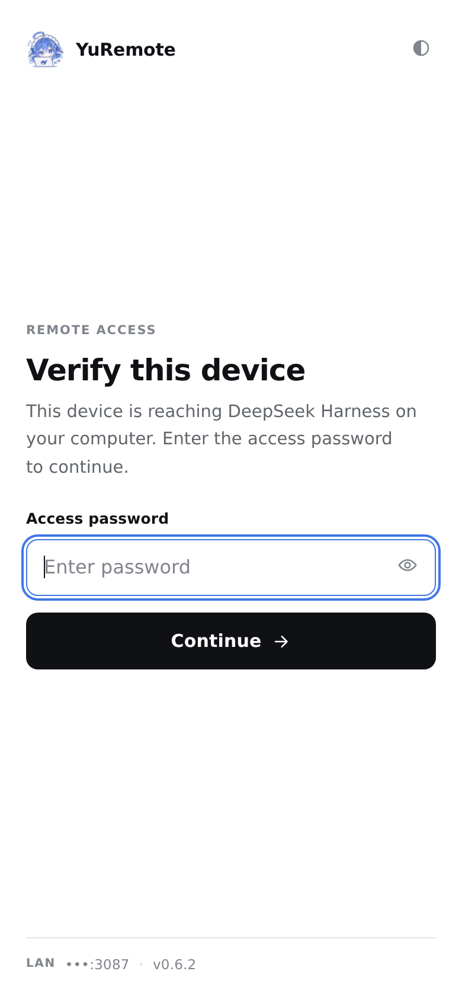
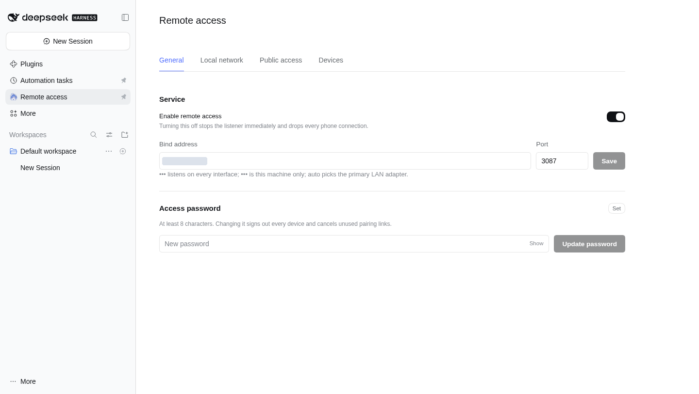
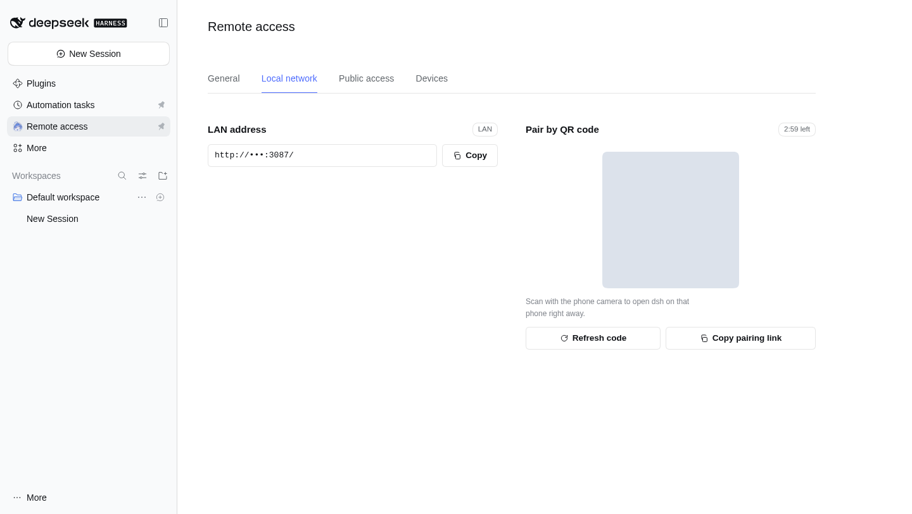
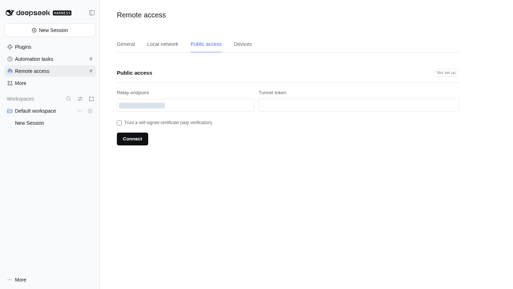
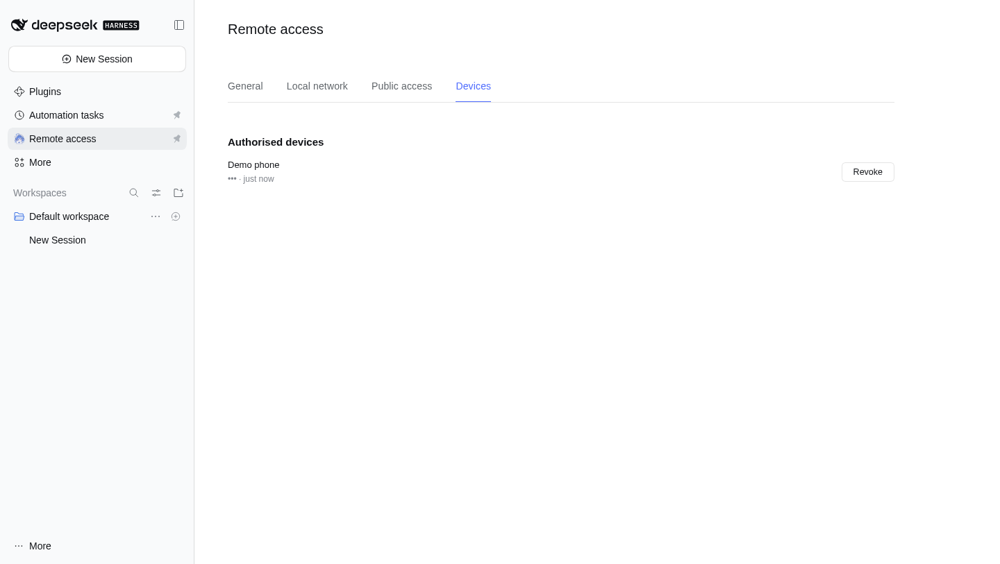
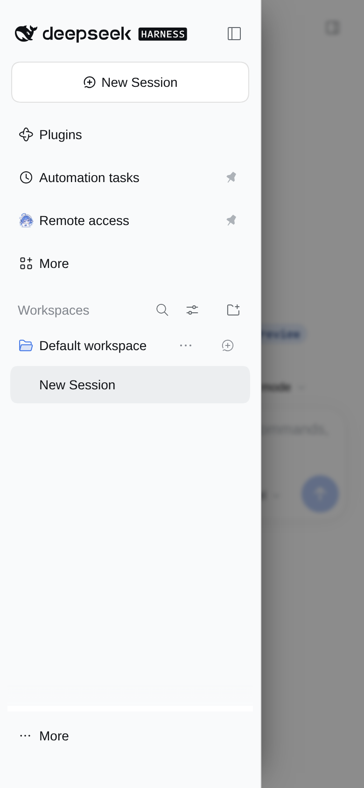
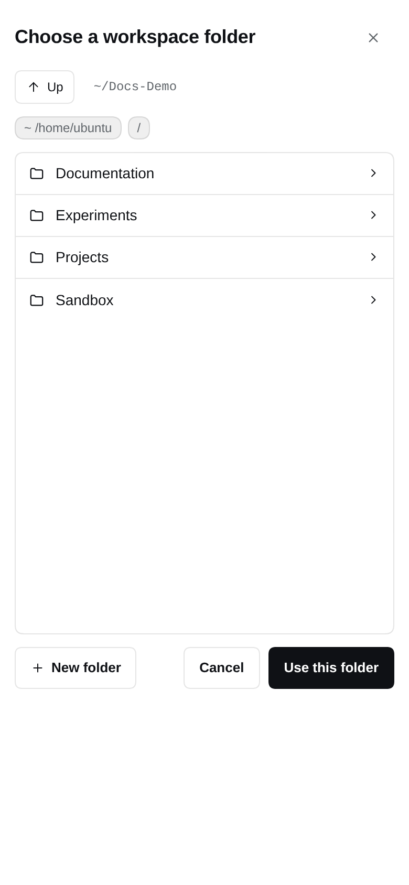

# Install, connect and configure

[文档中文版](GETTING-STARTED.zh-CN.md) · [Documentation](README.md#english)

## Install on the host

Use dsh 0.2.x (package range: `>=0.2.0-0 <0.3.0-0`) and Node.js 20+. The plugin has no npm runtime dependencies. Install in the dsh profile you actually use; the example targets Web.

```sh
git clone https://github.com/tsukii12/dsh-YuRemote.git
cd dsh-YuRemote
dsh --profile web --dump-config
sh install.sh -p web
dsh web --port 3080 --no-open
```

On Windows, run `dsh --profile web --dump-config` and then `.\install.ps1 -Profile web` from the checkout before starting dsh Web. For desktop, initialize the `desktop` profile, replace `web` with `desktop` in the install command, and restart the desktop app. Without a profile argument, the scripts target the existing desktop and web profiles. For a checkout install, update with `git pull`, rerun the same installer and restart dsh. To remove the plugin, use `sh install.sh -p web --uninstall` or `.\install.ps1 -Profile web -Uninstall`, then restart.

## Connect over your LAN

1. On the host, open the dsh Web launch URL locally, or open the desktop app. Do not share the dsh launch token.
2. Open **Remote access → General** in the sidebar, leave remote access enabled, and save an access password of at least eight characters.
3. On another device on the same network, open the URL shown under **Local network** and enter the portal password. The default gateway port is **3081**; the example dsh Web port **3080** is not the portal.



For passwordless enrollment, on the host open **Local network** and scan its pairing QR with the phone camera. Opening the link signs the browser in directly. The pairing link is single-use and expires after three minutes by default. Refresh the code to get a new link; do not share it publicly. For the in-app scanner, see [mobile app setup](APP.md).

## Remote access settings

### General

**Enable remote access** starts or stops the gateway; turning it off from a remote device disconnects that device and recovery requires access to dsh on the host. **Bind address** defaults to `0.0.0.0` (all interfaces); use `auto` to select the primary LAN IPv4 address, or `127.0.0.1` to keep access local to the host and any locally attached tunnel. **Port** defaults to `3081`; the panel accepts 1–65535. **Access password** accepts 8–200 characters; changing it in the panel signs out devices and cancels pending pairing links.



### Local network

Copy the address, scan the code, or copy the pairing link. Refresh an expiring code here. A loopback address cannot be dialed directly from another device.



### Public access

Enter the **Relay endpoint** (the agent listener) and **Tunnel token**, then connect. To edit an existing connection, leave the token blank to keep it; disconnect to remove the relay configuration. When online, copy the visitor URL or use the visitor QR. **Trust a self-signed certificate** skips relay certificate verification; prefer a trusted certificate or configure a CA file instead. See [public access](DEPLOY-SERVER.md).



### Devices

Review authorized sessions and revoke individual devices. Revocation blocks further authenticated requests; a revoked device can sign in again if it has a valid password or new pair link.



## When a connection fails

| Symptom | What to check |
| --- | --- |
| Portal is not listening | Set a password and enable remote access. If the port is already in use, select another port. |
| Works on the host, not on the phone | Use the address from **Local network**, not loopback. Check client isolation/guest Wi-Fi and allow the gateway TCP port from the LAN. |
| Pairing refused | Generate and scan a fresh QR code. For browser access you can also use the password. |
| Public relay disconnected or offline | Check the agent endpoint and its TLS scheme, tunnel token, and relay service. Use the full visitor URL including the tunnel prefix. |

On a narrow web viewport, use the drawer to reach workspaces and sessions; **Add workspace** opens the host folder picker.

 
