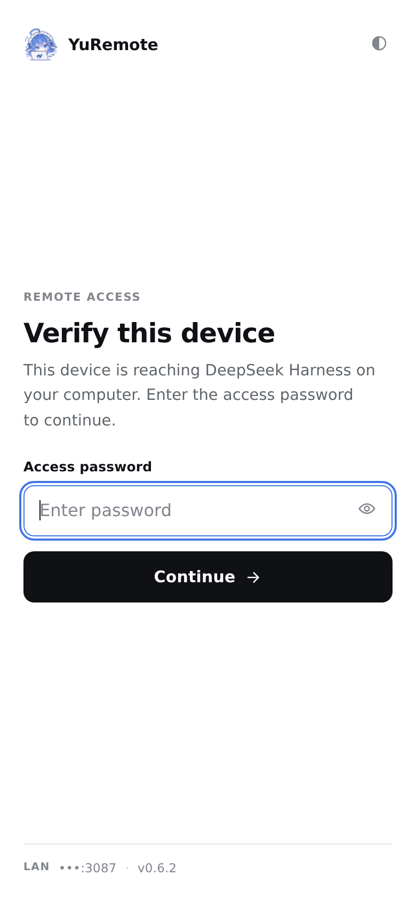
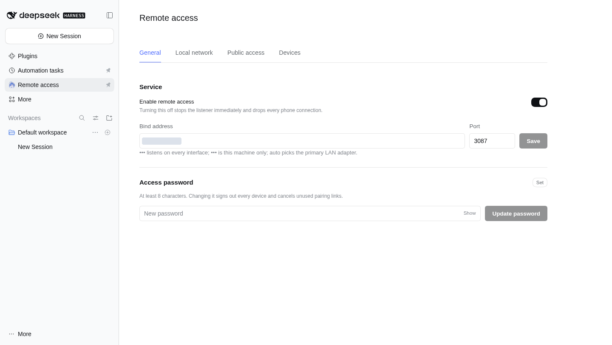
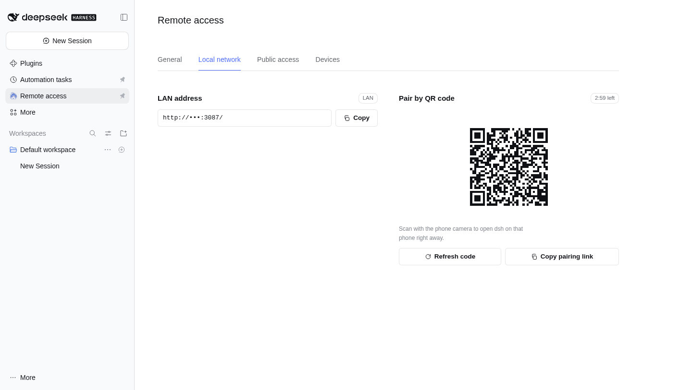
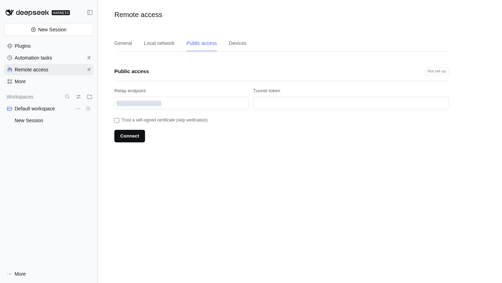
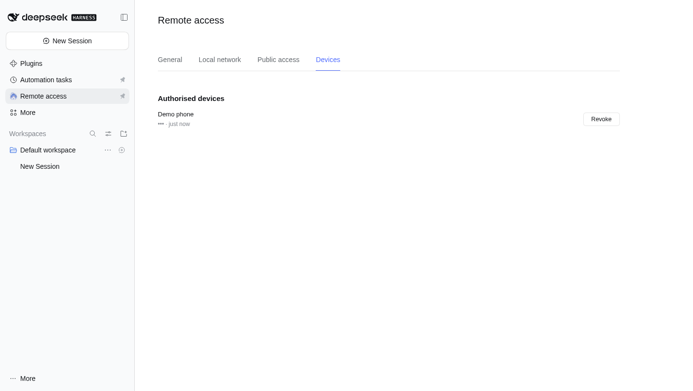
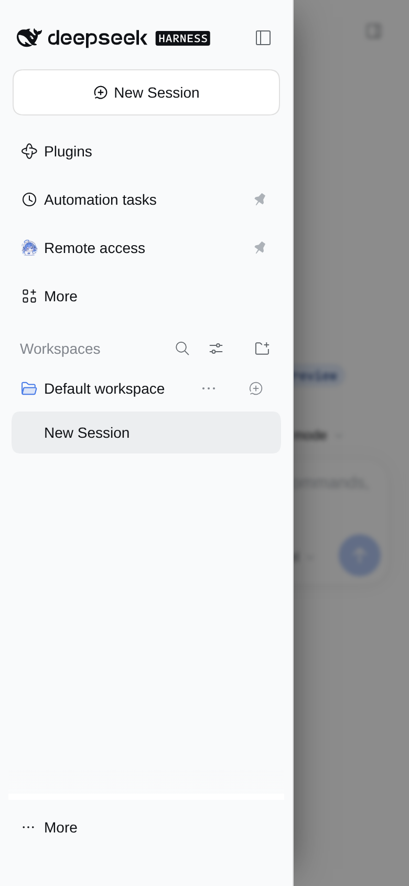
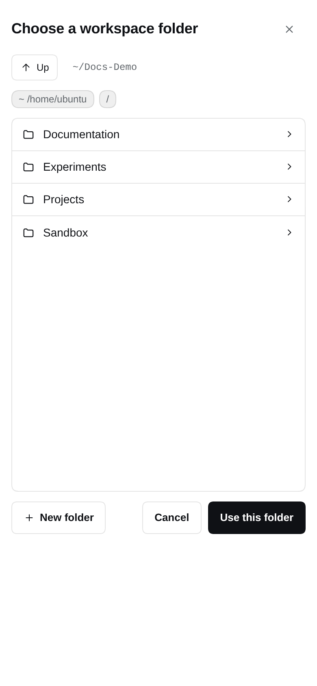

# 安装、连接与设置

[English](GETTING-STARTED.md) · [文档目录](README.md#简体中文)

## 在主机上安装

需要 dsh 0.2.x（软件包声明范围：`>=0.2.0-0 <0.3.0-0`）与 Node.js 20 或更高版本。插件无需额外的 npm 运行依赖。请安装到实际使用的 dsh 配置；下面以 Web 为例。

```sh
git clone https://github.com/tsukii12/dsh-YuRemote.git
cd dsh-YuRemote
dsh --profile web --dump-config
sh install.sh -p web
dsh web --port 3080 --no-open
```

Windows 下先运行 `dsh --profile web --dump-config`，再在检出目录运行 `.\install.ps1 -Profile web`，然后启动 dsh Web。使用桌面版时，先初始化 `desktop` 配置，将安装命令中的 `web` 改为 `desktop`，然后重启桌面应用。不指定配置时，脚本会安装到已有的 desktop 和 web 配置。通过检出目录安装的用户可运行 `git pull`，重新执行同一安装命令，再重启 dsh。要卸载插件，可运行 `sh install.sh -p web --uninstall` 或 `.\install.ps1 -Profile web -Uninstall`，然后重启。

## 通过局域网连接

1. 在主机本机打开 dsh Web 打印的启动地址，或打开桌面应用。不要分享 dsh 的启动令牌。
2. 从侧栏打开 **远程访问 → 基本设置**，保持远程访问开启，并保存至少 8 个字符的访问密码。
3. 在同一网络的另一台设备上打开 **局域网访问** 显示的地址，输入门户密码。网关默认端口为 **3081**；示例中的 dsh Web 端口 **3080** 不是门户。



若想免输密码，在主机上打开 **局域网访问**，用手机相机扫描配对二维码。打开链接后，浏览器会直接登录。配对链接只能使用一次，默认三分钟后过期。刷新可生成新链接；请勿公开分享。应用内扫码见[移动应用指南](APP.zh-CN.md)。

## 远程访问设置

### 基本设置

**启用远程访问** 用于启动或停止网关；从远程设备关闭时，连接会断开，需要回到主机上的 dsh 才能重新开启。**绑定地址** 默认 `0.0.0.0`（所有网卡）；`auto` 选择主局域网 IPv4 地址，`127.0.0.1` 则仅限本机和本机上的隧道访问。**端口** 默认 `3081`，面板接受 1–65535。**访问密码** 支持 8–200 个字符；从面板修改密码会让设备退出登录，并取消未使用的配对链接。



### 局域网访问

可复制地址、扫码或复制配对链接，也可刷新即将过期的二维码。其他设备无法直接连接回环地址。



### 公网访问

填写 **中转服务器**（代理端口的地址）和 **隧道令牌**，然后连接。修改现有连接时，令牌留空表示沿用原值；断开会移除中转配置。在线后可复制访客地址或使用访客二维码。**信任自签名证书** 会跳过中转证书校验；优先使用受信任的证书，或配置 CA 文件。见[公网访问指南](DEPLOY-SERVER.zh-CN.md)。



### 设备管理

查看已授权会话，按设备撤销授权。撤销会阻止后续已认证请求；如果设备仍持有有效密码或新配对链接，则可重新登录。



## 无法连接时

| 现象 | 检查项 |
| --- | --- |
| 门户没有监听 | 设置密码并启用远程访问。如果端口被占用，更换端口。 |
| 本机能打开，手机不能 | 用 **局域网访问** 显示的地址，而不是回环地址。检查访客 Wi-Fi 或客户端隔离，并允许局域网访问网关 TCP 端口。 |
| 配对失败 | 生成新二维码后重新扫码。网页端也可使用密码。 |
| 公网中转断开或离线 | 检查代理端地址及 TLS 协议、隧道令牌和中转服务。使用包含隧道路径前缀的完整访客地址。 |

网页端在窄屏下通过抽屉访问工作区和会话；**添加工作区** 会打开主机目录选择器。

 
